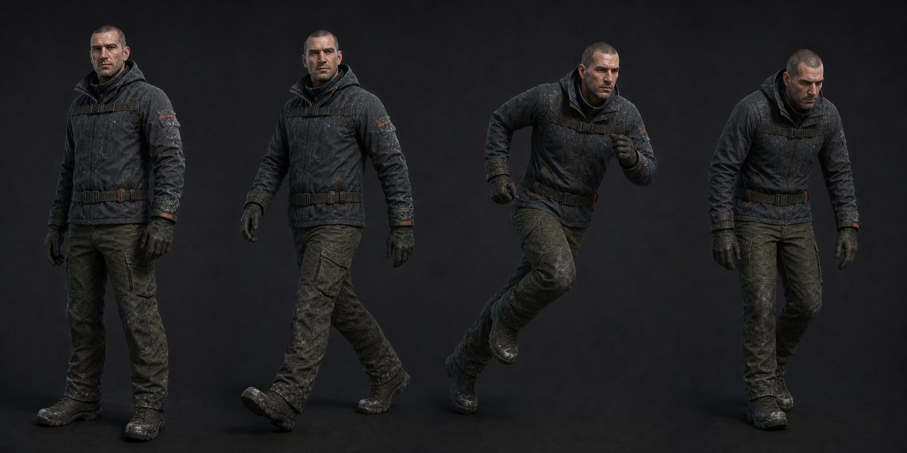

# 01 · 이동

| 클립 | 핵심 프레임 | 접지·중심 규칙 |
| --- | --- | --- |
| `Player_Idle` 90f | 0=중립, 45=들이쉼, 90=0 복사 | COG Y 8mm, 가슴 회전 1.2° 이하. 오른발 55%, 왼발 45% |
| `Player_Walk` 30f | 0 L contact, 8 down, 15 R contact, 23 down, 30=0 | 발바닥 미끄럼 5mm 이하, 보폭 0.93m, 상체 반회전 4° |
| `Player_Sprint` 24f | 0 L contact, 6 flight, 12 R contact, 18 flight, 24=0 | 전경 11°, 보폭 1.53m, 팔꿈치 75~95°, 무거운 부츠 후행 |
| `Player_ExhaustedWalk` 36f | 0/18 contact, 9/27 down | 보폭 0.72m, 어깨 +25mm, 머리 -7°, 손은 느슨하게 펼침 |

클립은 제자리 루프다. `CharacterController.velocity`의 XZ 크기로 Blend Tree를 구동한다.
발소리는 애니메이션 이벤트가 아니라 현재 `PlayerMotor`의 거리 누적 로직을 유지해
속도·웅크림에 맞춘다. Idle 호흡은 카메라 sway와 중복되지 않게 머리 이동 2mm 이하다.

Walk·Sprint의 첫/마지막 발 행렬은 동일해야 한다. 좌우 이동과 후진은 별도 클립을
만들지 않고 2D Blend Tree에서 재생 속도와 상체 yaw 보정으로 처리한다.

