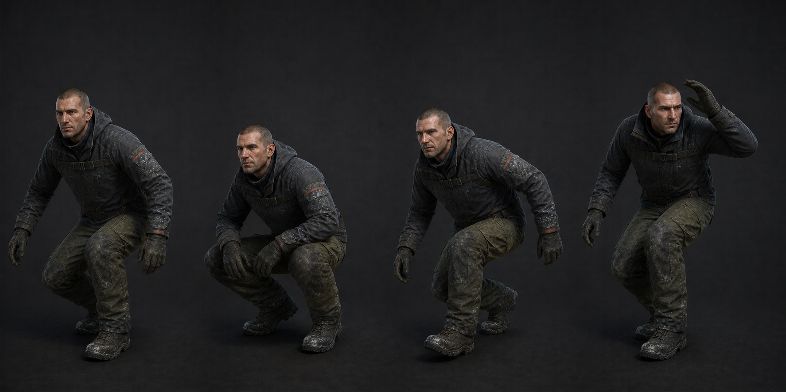

# 02 · 웅크리기

| 클립 | 핵심 프레임 | 규칙 |
| --- | --- | --- |
| `Player_CrouchEnter` 6f | 0 서기, 3 중간, 6 웅크림 | COG -0.48m, 머리 최고점 1.10m, 발 위치 고정 |
| `Player_CrouchIdle` 60f | 0/60 동일, 30 호흡 | 높이 1.10m 안, 뒤꿈치 접지, 무릎은 발끝 방향 |
| `Player_CrouchWalk` 36f | 0 L contact, 18 R contact, 36=0 | 보폭 0.47m, 발 높이 35mm 이하, 팔 흔들림 작게 |
| `Player_CrouchExit` 6f | Enter 역방향 | 머리부터 들지 않고 골반·가슴 동시 상승 |

코드 전환은 0.18초라 30fps 5.4f다. 클립은 6f로 제작하고 Unity normalized time을
1.0까지 0.18초에 맞춘다. `BlockedAbove()`가 참이면 Exit를 시작하지 않는다.

웅크림은 무릎 꿇기나 네발 자세가 아니다. 카메라 눈높이 0.95m와 메시 눈 위치 오차는
±2cm 이내다. 무기 UpperBody 레이어는 유지하되 산탄총 개머리판이 무릎과 겹치면
손 IK를 위로 3cm 올린다.

