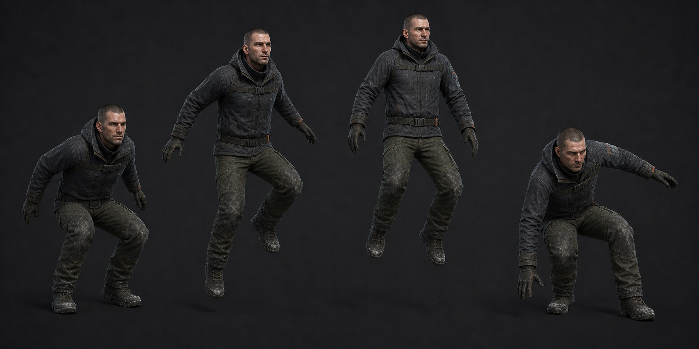

# 03 · 점프·착지

| 클립 | 프레임 | 규칙 |
| --- | ---: | --- |
| `Player_JumpStart` | 8f | 0~3 압축, 4 이륙 이벤트, 8 다리 회수. 수직 Root 이동 없음 |
| `Player_Airborne` | 12f loop | 상승/하강 공용 중립. `VerticalSpeed`로 발끝과 팔만 보간 |
| `Player_Land` | 10f | 0 접촉, 3 최대 압축, 7 회복, 10 이동 중립 |

실제 포물선은 `gravity=-20`, `jumpHeight=0.9` 코드가 담당한다. `JumpStart`의 4f에서
발이 떨어져 보이지만 Root Y는 0이다. `CharacterController.isGrounded`가 false가 되면
Airborne으로 전환하고, 다시 true가 되는 프레임에 Land를 시작한다.

낙하 시간이 길어도 별도 공포 낙하 클립을 만들지 않는다. 아래로 8m/s 이상이면
Airborne의 다리를 10° 더 펴는 additive만 허용한다. Land는 양발 접촉을 기준으로 하되
경사면에서는 IK로 발 높이만 보정하고 골반 이동은 4cm 이하로 제한한다.

