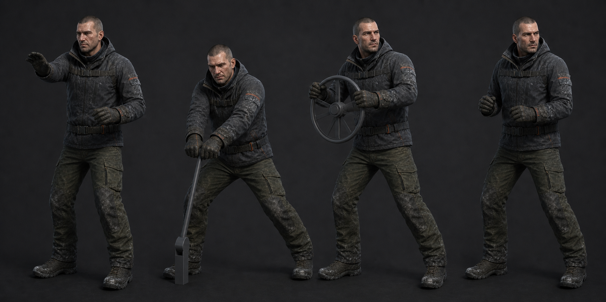

# 04 · 시설 상호작용

| 클립 | 프레임 | 손·이벤트 계약 |
| --- | ---: | --- |
| `Player_InteractReach` | 18f | 0 중립, 8 오른손 접촉, **9 InteractCommit**, 18 복귀 |
| `Player_LeverPull` | 36f | 8 양손 고정, 10~24 -55° 추종, **24 InteractCommit**, 36 해제 |
| `Player_ValveTurn` | 60f | 8 양손 고정, 12~48 총 150° 회전, **48 InteractCommit**, 60 해제 |

일반 `PlayerInteractor`는 현재 E 입력 즉시 `Interact()`를 호출한다. 애니메이션 적용 시
실제 장치 발동을 위 `InteractCommit` 이벤트까지 지연하는 bridge가 필요하다. 구현 전에는
시각 동작만 재생하고 기존 즉시 호출을 유지해 게임 진행을 막지 않는다.

- 상호작용 대상은 카메라 전방 2.5m 안이다. 손 IK 대상은 실제 손잡이 transform을 쓴다.
- Lever의 실제 시각 회전은 0.25초이므로 손이 잡힌 10~24f 안에서 완료한다.
- Valve는 현재 공용 인터페이스에 시간 계약이 없으므로 2초 상체 연출로 고정한다.
- 이동 입력이 생기거나 피격되면 IK weight를 4f에 걸쳐 0으로 내려 즉시 취소한다.
- 1인칭에서는 팔만 보이고 전신은 그림자에 사용한다. 카메라를 애니메이션으로 돌리지 않는다.

