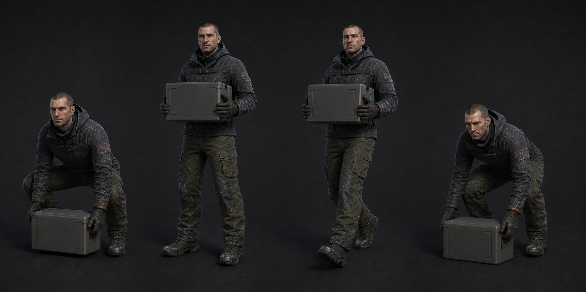

# 05 · 양손 운반

| 클립 | 프레임 | 계약 |
| --- | ---: | --- |
| `Player_CarryLift` | 24f | 0 손 뻗기, 6 양손 고정, **8 AttachProp**, 18 가슴 위치, 24 Idle |
| `Player_CarryIdle` | 60f loop | 물체 중심 눈 아래 0.52m, 팔꿈치 78~95°, 호흡 5mm 이하 |
| `Player_CarryWalk` | 36f loop | 보폭 0.64m, 상체 역경 4°, 물체 회전 ±1.5° |
| `Player_CarryDrop` | 18f | 0 Hold, 12 바닥 직전, **13 DetachProp**, 18 손 해제 |

운반 대상은 연료통·축전지 공용이며 20kg 인상으로 만든다. 손 위치는 개별 오브젝트의
`CarryGrip.L/R`에 IK로 붙이고 오브젝트 크기가 달라도 팔꿈치 pole만 재계산한다.

현재 기획대로 운반 중 무기와 재장전을 모두 끈다. 다른 장치와 E 상호작용은 가능하므로
CarryIdle 상체 위에 `InteractReach`를 올릴 수 있게 오른손 IK weight를 잠시 해제한다.
허공 E에서만 Drop을 재생한다. 물체 물리 활성은 `DetachProp` 뒤 한 프레임에 켠다.

운반 중 달리기 전용 클립은 만들지 않는다. `PlayerMotor`가 달리기를 허용하더라도
Animator bridge가 Carrying일 때 locomotion speed를 Walk 계열로 고정해야 한다.

