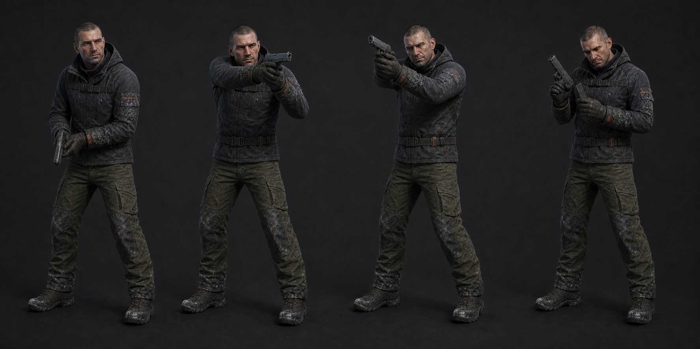

# 06 · 권총

총기 보드의 회색 권총은 파지용 프록시다. 최종 총기 외형은 무기 시안 선택 뒤 교체한다.

| 클립 | 프레임 | 손·이벤트 계약 |
| --- | ---: | --- |
| `Player_PistolEquip` | 15f | 0 화면 아래, 12 로우 레디, **13 WeaponReady**, 15 Idle |
| `Player_PistolIdle` | 60f loop | 오른손 grip 고정, 왼손 보조, 총구 조준점 아래 7° |
| `Player_PistolFire` | 8f | **1 Fire**, 2 총구 +1.6°, 5 회복 70%, 8 Idle |
| `Player_PistolReload` | 54f | 8 탄창 해제, 16 제거, 30 새 탄창 접근, **39 MagazineIn**, 48 슬라이드 확인, **54 ReloadComplete** |

- 방아쇠 검지는 Fire 1f에만 안으로 들어가고 나머지는 프레임 밖에 둔다.
- 카메라 반동은 현재 `PlayerLook.AddRecoil(1.6°, ±0.6°)`가 담당한다. 팔 애니메이션은
  이를 중복하지 않고 손목·팔꿈치에 40%만 표현한다.
- `PlayerWeapon`은 현재 발사 즉시 탄을 줄이고 재장전 1.8초 끝에서 탄을 채운다.
  이벤트는 SFX/손 위치 동기화용이며 게임 탄약 변경 시점을 바꾸지 않는다.
- 재장전 중 무기 전환·운반 시작 시 4f crossfade 뒤 Idle로 돌아가며 탄약은 채워지지 않는다.
- Walk/Crouch는 Base Layer, 권총은 UpperBody Override로 재생한다. Sprint 중 총은 화면
  아래로 내려 Fire를 막는 것이 권장되나 현재 코드가 허용하면 Fire 우선순위를 따른다.

