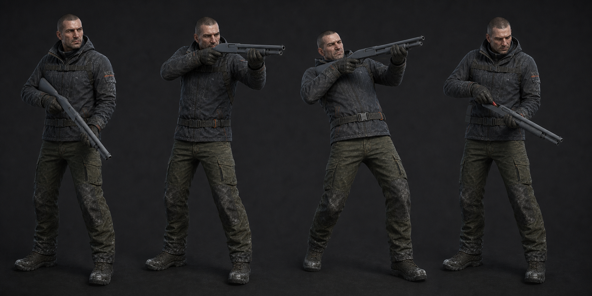

# 07 · 산탄총

보드의 회색 산탄총은 4발 펌프액션 파지 프록시다. 최종 무기 모델을 선택해도 오른손
grip, 왼손 pump, 오른쪽 shoulder socket 세 기준점은 유지한다.

| 클립 | 프레임 | 손·이벤트 계약 |
| --- | ---: | --- |
| `Player_ShotgunEquip` | 18f | 0 아래, 14 견착, **16 WeaponReady**, 18 Idle |
| `Player_ShotgunIdle` | 60f loop | 개머리판 우측 어깨, 총구 조준점 아래 9°, 왼손 pump |
| `Player_ShotgunFirePump` | 30f | **1 Fire**, 3 +3.4° 반동, 10 pump unlock, 15 후퇴, **16 Eject**, 23 전진·장전, 30 Idle |
| `Player_ShotgunReload` | 78f | 0 안쪽 roll, 12 포트 노출, 18/32/46/60 shell pose, **68 TubesClosed**, **78 ReloadComplete** |

- 현재 발사 간격은 0.9 shots/s, 약 33.3f다. 30f 액션 뒤 최소 4f cooldown을 코드가 보장한다.
- 카메라 반동 3.4°/±1.2°와 팔 반동이 합쳐져 과장되지 않게 팔에는 45%만 넣는다.
- 재장전 코드는 2.6초 끝에서 필요한 탄을 일괄 충전한다. 시각상 4개 shell pose가 있어도
  중간 취소 시 일부 탄이 들어가지 않는다. 부분 장전을 구현하기 전까지 이 계약을 유지한다.
- Fire가 Reload보다 우선하지 않는다. 재장전 중 발사 입력은 무시하는 현재 코드와 맞춘다.
- Crouch에서는 개머리판 위치를 유지하고 팔꿈치만 4cm 위로 보정해 무릎 관통을 막는다.

## 팔이 이 산탄총에 짧다 (2026-08-09)

손 포즈를 풀면서 나왔다. 권총과 같은 자리에서 들면 **펌프가 카메라 앞 0.81 m 에
놓이는데 왼팔은 어깨부터 손끝까지 0.595 m 라 279 mm 모자란다.** 손잡이 웹에서
펌프 중앙까지가 0.46 m 이고([`09-weapons.md`](09-weapons.md)) 어깨 사이가 0.31 m
라, **총구를 왼쪽 아래로 눕히고 손잡이를 몸 가까이 두어야** 왼손이 펌프에 닿는다.

`Player_ShotgunIdle` 의 「개머리판 우측 어깨」는 이 모델에 개머리판이 없으므로
해당하지 않는다. 견착 대신 **몸 앞 낮은 자세**로 만든다.

### 기준 자세 (2026-08-09, 두 번 정정)

처음에 「손잡이 웹 `(0.16, −0.06, −0.36)`, 총구 `(−0.55, −0.80, −0.24)`」로 적었다.
점 사이 거리만 계산한 값이라 **손이 손목이 아니라 물갈퀴로 놓인다**는 것을 빼먹었고,
리그로 재니 손목이 38° 로 상한을 넘었다.

그다음 「양손 파지가 아예 성립하지 않는다」고 적었다. **그것도 틀렸다.** 자세를
훑던 코드가 손목 위치를 **그립 점**과 비교하고 있었는데, 그 둘은 구조상 56 mm
떨어져 있다. 그래서 어떤 자세를 넣어도 똑같이 ~53 mm 어긋난다고 보고했고 그것을
도달 실패로 읽었다. 비교 대상을 손목 목표로 고치니 **486 자세 중 274 개가
성립한다.**

확정값은 아래다. `find_stance.py` 가 도달 · 손목 · 화면 안에 들어오는 비율을 같이
보고 고른다.

| | 값 |
| --- | --- |
| 손잡이 웹 | `(0.06, −0.22, −0.18)` |
| 총구 방향 | `(−0.70, −1.00, −0.40)` |
| 롤 | 45° |
| 화면에 나오는 비율 | 산탄총 83 %, 펌프 100 % (FOV 80) |
| 최악 손목 | 34.7° (상한 35) |

**팔 길이는 그대로다.** 늘릴 필요가 없었다. `build_arms.py` 에 `ARM_EXTENSION`
손잡이만 0 으로 남겨두었다 — 나중에 정말 안 들어가는 무기가 오면 그때 쓸 자리다.

### 아직 남은 것 — 탄 주머니에서의 왼손

`Arms_ShotgunReload` 는 78f 로 서고 이음새가 0.000 mm 인데, **탄을 집는 구간에서
왼손목이 77.6° 로 상한을 넘는다.**

원인은 찾았다. `Shell` 본이 `WeaponRoot` 의 자식이라 **주머니에 있는 동안에도 총의
롤 97° 를 그대로 물려받는다.** 그래서 손이 「총에 맞춰 누운 탄」을 잡으라는 요구를
받는다. 실제로는 주머니의 탄은 손이 방향을 정하고, 포트로 가면서 총에 정렬된다.

고치는 방법은 `Shell` 본의 회전을 주머니에서 키잉해 포트로 가며 0 으로 섞는 것이다.
부모가 포즈된 상태의 회전 변환이라 [`decisions.md`](../../../../tech-design/decisions.md)
의 「부품은 rest 행렬이 아니라 실제 사슬로 놓는다」와 같은 함정이 있으므로, 위치에
쓴 방법(축마다 재서 쓰기)을 회전에도 똑같이 적용한다.
