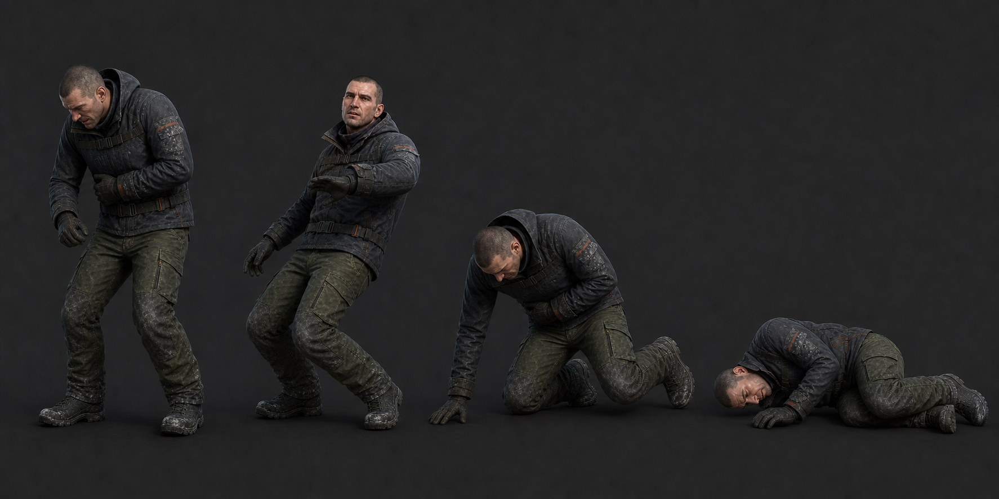

# 08 · 피격·사망

> 2026-08-09 · 전신이 아니라 팔 기준으로 만들었다 — `Arms_Hit`(12f, **Additive**)
> 와 `Arms_Death`(36f).
>
> Additive 클립은 **1프레임이 곧 기준 포즈**다. Unity 가 첫 프레임과의 차이를
> 얹기 때문이고, 그래서 `Arms_Hit` 도 `Arms_Sway` 도 맨손 Idle 자리에서 출발해
> 거기로 (`Hit` 은 80 % 만) 돌아온다.

| 클립 | 프레임 | 계약 |
| --- | ---: | --- |
| `Player_Hit` | 12f | 0 중립, 2 왼쪽 갈비 충격, 6 최대 수축, 12 80% 복원 |
| `Player_Death` | 36f | 0 피격, 8 뒤로 비틀림, 18 무릎/손 접촉, 29 옆면 접촉, 36 정지 |

Hit는 방향별 네 클립을 만들지 않는다. `DamageInfo.Direction`을 로컬 XZ로 바꿔 상체
additive의 yaw/roll 부호만 조절한다. 0.8초 무적 시간은 애니메이션 길이와 별개다.

사망 시 `PlayerHealth`가 입력을 즉시 끄고 `Died`를 보낸다. Animator bridge는 Died에서
무기·운반물을 먼저 숨기고 Death를 FullBody Override로 재생한다. 1인칭에서는 0~24f
카메라를 0.9m까지 코드로 낮추고 roll은 18° 이하로 제한한다. 애니메이션이 카메라
transform을 직접 키잉하지 않는다.

래그돌, 피, 절단, 추가 사망 방향은 만들지 않는다. 36f 마지막 포즈에서 Collider를
끄거나 체크포인트 재시작으로 넘어가며, 반복 재생하지 않는다.

