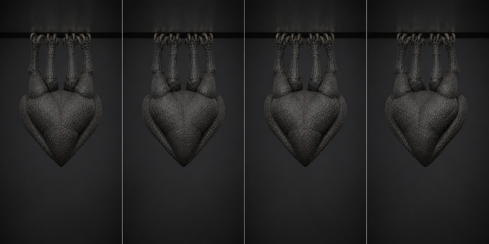

# 01 · `Clinger_Cling_Folded`

상태: 2026-08-09 개정. 60f 미세 호흡 → 90f 연동 운동.

## 역할

- 90f + 이음매 1f = 파일 91f, 30 fps, 3.00초, Loop.
- 천장에 매달린 기본 대기. 멀리서는 구조물 같은 덩어리로 읽히고, 가까이서는
  **안에서 뭔가가 지나가는 것**이 보인다.
- 갈고리 8개는 전 구간 천장에 고정된다. 움직이는 것은 거기 매달린 몸이다.

## 왜 3초인가

호흡을 5 mm 수축으로 만들면 6 m 거리에서 완전히 사라진다. 대신 **삼킴 한 번**을
클립 전체로 만든다. 머리 쪽에서 시작한 덩어리가 배를 지나 등까지 가는 데 필요한
시간이 3초다. 1초로 줄이면 삼킴이 아니라 경련이 되고, 그건 `Cling_Tremor`의 몫이다.

## 키포즈

| 프레임 | 포즈 |
| ---: | --- |
| 1 | 접힘 1.0, 갈고리 8개 고정. 삼킴 위상 0(머리 쪽), 하중은 LF/RR 대각선 |
| 14 | 삼킴이 목을 지난다. `FoldBody` 26°, 몸통 전체가 12 mm 내려앉음 |
| 28 | 삼킴이 배 한가운데. `FoldBody` 38°, 하강 최대 **45 mm**, `TorsoMid` +9° |
| 40 | 하중이 RF/LR 대각선으로 넘어간다. 몸이 x +22 mm 미끄러짐, roll 4° |
| 52 | 삼킴이 등에 도달. `FoldBody` 0°, `TorsoBase` −11°, 몸 32 mm 상승 |
| 62 | 턱이 5° 벌어졌다가 |
| 68 | 다시 닫힌다. 머리는 이 사이 14f 동안 −9° 회전 |
| 76 | 하중이 LF/RR로 되돌아온다. x −22 mm, roll −4° |
| 90 | 1f로 수렴. 이음매 오차 0 |
| 91 | 1f 복제 |

## 제작값

- 갈고리 IK 4개 영향력 1.0 고정. 갈고리 끝 이동 허용치 **2 mm**.
- 몸통 수직 이동 **45 mm**, 좌우 **22 mm**, roll **±4°** — 초판의 9배다.
  실루엣 폭은 갈고리가 잡고 있으므로 바운드는 넘지 않는다.
- 삼킴은 `FoldBody` 회전과 `TorsoMid`/`TorsoTip`의 위상차로 만든다. 세 커브의
  최고점을 **7f씩 어긋나게** 두는 것이 전부다. 같은 프레임에 몰리면 그냥 박동이 된다.
- 대각선 하중 교대의 주기는 삼킴 주기의 **정확히 절반이 아니다**(36f vs 90f).
  두 리듬이 클립 안에서 한 번도 겹치지 않아야 살아 있는 것으로 읽힌다.
- 손가락은 `DigitsGroup` 24° 감김에서 ±6° 안에서 두 번 조인다. 초판은 이것을
  금지했는데(「곤충 같은 인상」), 이 개체는 손가락이 셋뿐이라 곤충으로 안 읽힌다.
- Noise modifier는 쓰지 않는다. 모든 커브는 손으로 잡은 키 사이의 보간이다.

## 검수

- 91f와 1f의 전 deform 본 월드 행렬 차 **0.0000 m / 0.000°**(실측).
- 정지 접힘은 `1.83 × 1.29 × 1.28 m`. 클립 전체로는 높이가 **1.63 m**까지 늘어나는데,
  삼킴이 지나갈 때 몸이 45 mm 내려앉고 척추가 펴지기 때문이다.
- 천장(z = 0) 위로 **24 mm**. 갈고리가 물어 들어간 만큼이다.
- 3초 동안 실루엣 높이가 1.29 → 1.63 m로 변한다. 가까이서는 삼킴이 지나가는 것이
  보이고, 6 m 거리에서는 「가만히 있는 것이 아니다」 정도로만 읽힌다. 이 클립은
  경고가 아니라 배경이므로 그게 맞다 — 경고는 `Cling_Tremor`가 한다.
