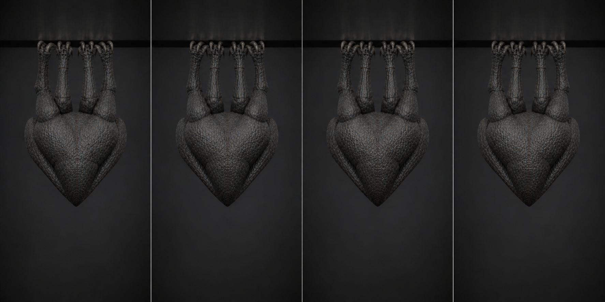

# 02 · `Clinger_Cling_Tremor`

상태: 2026-08-09 개정. 36f 3° 떨림 Loop → 40f 전신 경련 One-shot.
천장 피격 반응도 이 클립이 겸한다.

## 역할

- 40f, 30 fps, 1.30초, **One-shot**.
- 플레이어가 가까워졌음을 알리는 경계 동작이자, 천장에 매달린 채 총에 맞았을 때의
  반응이다.
- 갈고리 8개는 끝까지 놓지 않는다. 놓으면 `Unfold_Drop`이 된다.

## 왜 Loop가 아닌가

떨림을 반복 재생하면 3초 뒤에는 배경이 된다. 경고는 한 번만 유효하다. 상태 기계는
`Cling_Folded` → `Cling_Tremor` → `Cling_Folded`로 되돌리고, 플레이어가 계속
가까이 있으면 **간격을 두고 다시** 재생한다.

## 왜 피격 반응을 겸하는가

Generic 리그에서 additive 피격은 참조 포즈 클립을 요구하고, 천장·지상 두 기준
포즈가 있으면 참조도 둘이 된다. 천장 피격은 「매달린 채 경련한다」가 정답이고
그건 이 클립이 이미 하는 일이다. → 클립 하나와 additive 배선이 사라진다.

## 키포즈와 위상

| 프레임 | 주도 | 포즈 |
| ---: | --- | --- |
| 1 | — | `Cling_Folded` 1f와 동일. 여기서 튀면 전환이 보인다 |
| 3 | LF 뿌리 | **1차 경련.** 몸이 갈고리 아래로 60 mm 떨어졌다 걸린다. roll −9° |
| 7 | — | 걸림. `TorsoMid` +14°, 팔이 몸통에서 90 mm 떨어짐 |
| 11 | RR 뿌리 | **2차.** 반대쪽으로 roll +12°, 하강 40 mm |
| 17 | RF 뿌리 | **3차 최대.** 하강 **75 mm**, `TorsoBase` −18°, 손가락 32° 벌어짐 |
| 18 | 턱 | `Jaw` **30°** — 2f 동안만 열린다 |
| 20 | — | 턱 닫힘. 이 2f가 클립에서 유일하게 입 안이 보이는 곳이다 |
| 25 | LR 뿌리 | **4차.** 진폭 절반, roll −6°, 하강 24 mm |
| 31 | — | 여진. 네 사지 뿌리가 서로 다른 위상으로 3~5° |
| 40 | — | `Cling_Folded` 1f로 복귀. 오차 2 mm / 1° 이하 |

## 제작값

- 경련 한 번은 **2f 가속, 6~10f 불규칙 감쇠**. 감쇠 길이를 네 번 다 다르게 둔다.
- 갈고리 IK 4개는 1.0 고정. 몸이 떨어져도 갈고리 끝은 2 mm 안에 머문다.
  **이 대비가 클립의 전부다** — 붙어 있는 것과 매달린 것의 차이.
- 네 경련의 최고점 프레임은 최소 4f씩 떨어져 있다(3 / 11 / 17 / 25).
- 몸통 하강 최대 75 mm, roll ±12°, 접힌 높이 변화 90 mm 이하.
- 1f와 40f는 `Cling_Folded` 1f를 그대로 복제해서 만든다. 손으로 비슷하게
  맞추지 않는다.

## 검수

- 1f와 40f가 `Cling_Folded` 1f와 각각 2 mm / 1° 이내다.
- 6 m 거리 64 px 실루엣에서 3차 경련(17f)이 보인다.
- 갈고리 8개가 전 구간 천장 평면에서 2 mm 이상 미끄러지지 않는다.
- 연속 재생해도 몸통 회전이 누적되지 않는다.
