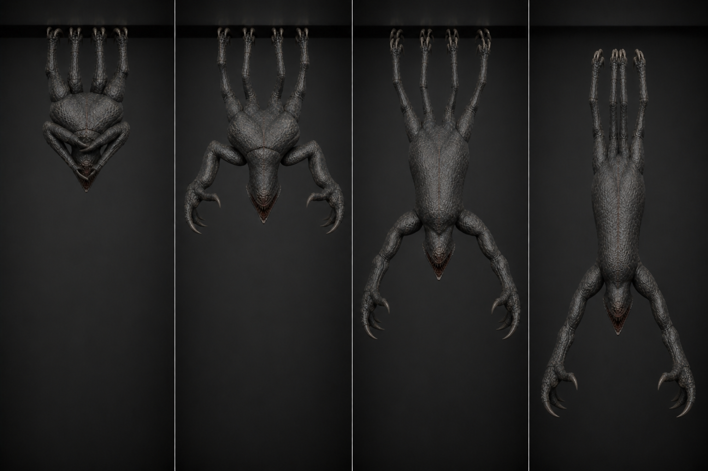

# 03 · `Clinger_Unfold_Drop`

상태: 2026-08-09 개정. 길이와 이벤트 프레임은 그대로, 진폭만 키움.

## 역할

- 24f, 30 fps, 0.80초, One-shot, in-place.
- 접힌 천장 덩어리가 펴지고 10f에 천장 고정을 해제한다.
- 애니메이션은 자세만 만들며 실제 낙하 거리와 속도는 코드/중력이 처리한다.

## 프레임과 이벤트

| 프레임 | 단계 | 포즈 / 이벤트 |
| ---: | --- | --- |
| 1 | 접힘 | `Cling_Folded` 1f, 갈고리 8개 Ceiling IK |
| 4 | 과압축 | **접힘을 넘어 더 조인다.** fold 1.18, 몸이 천장 쪽으로 70 mm 더 붙고 척추가 22° 더 말림. 스프링을 감는 프레임 |
| 8 | 예고 | 팔이 몸통에서 떨어지기 시작(splay 0.35), 턱 12° |
| **10** | **해제** | `AE_DropRelease` 1회. 갈고리 IK 영향력 1.0 → 0.0, 코드 낙하 시작 |
| 13 | 채찍 | 사지 4개가 중립을 지나 위로 튕긴다(spread 1.0). 몸통은 아직 말려 있다 |
| **18** | **과전개** | 척추가 곧은 것을 **26° 지나쳐 뒤로 젖혀진다.** 팔 reach 1.25로 앞·바깥 최대, 턱 **48°**, 손가락 −30° 젖힘. **실측 폭 2.49 m** |
| 21 | 반동 | 팔이 15% 되돌아오고 턱 26°. 사지는 여전히 펴진 채 떨림 |
| 24 | 유지 | 낙하 자세. 이후 이 포즈를 hold하고 `Land`로 이어진다 |

## 왜 과전개인가

접힌 것이 펴져서 «정확히 곧은» 상태로 멈추면 기계로 읽힌다. 관절이 자기 한계를
지나쳤다가 되돌아오는 2~3 프레임이 «제어를 잃은 몸»을 만든다. 18f가 클립에서 유일하게
`2.01 m` 폭을 쓰는 프레임이고, 플레이어가 위를 올려다봤을 때 시야를 채우는 것도 여기다.

## 리깅과 키 작업

- Root 위치/회전은 0. f1~9 갈고리 8개는 천장 평면에서 **2 mm 이상 움직이지 않는다.**
- f10에서 IK 영향력을 4개 동시에 0으로 떨어뜨린다. 전환 프레임 전후로 사지 본의
  월드 회전이 이어지도록 f10 직전 포즈를 FK로 복사해두고 f10에 키를 잡는다.
- 공격 팔은 좌우 **2f 위상차**를 둔다(초판 1f). f18에는 양쪽이 모두 최대다.
- 몸통 곡률은 `TorsoBase/Mid/Tip`에 0.30 / 0.45 / 0.25로 나눈다. 사람처럼 목을
  젖히거나 팔을 날개처럼 벌리지 않는다.
- f10 이후에도 Root/Object는 아래로 이동하지 않는다. 영상에서 보이는 낙하는
  Unity Transform/중력 시험으로만 확인한다.
- 낙하 시간이 24f보다 길면 f24 포즈를 clamp로 유지하고 clip 속도를 늦추지 않는다.

## 코드 계약

- `AE_DropRelease`에서는 천장 **고정 상태만** 해제한다. Sphere r 0.52는 공중 본체
  Collider로 유지하고 지상 Capsule과 Agent는 아직 켜지 않는다.
- SphereCast r 0.52로 바닥을 예측하고, **접촉 직전에 Transform을 접점으로 옮기면서**
  `Land`로 전환한다. → [`00-rigging.md`](00-rigging.md)의 「공간 전환」
- 이벤트가 transition/프레임 드롭으로 중복돼도 한 개체당 한 번만 낙하 상태에 들어간다.

## 검수

- 10f 전까지 천장 고정, 10f 뒤 자유 낙하가 프레임 단위로 구분된다.
- 18f 폭이 2.49 m, 클립 최대 높이가 2.55 m다(실측).
- 4f 과압축이 접힘 바운드를 넘지 않는다(천장 관통 35 mm 이하).
- 2.6 m와 4.0 m 천장에서 같은 clip 속도로 내려오며 낙하 거리만 코드가 바꾼다.
