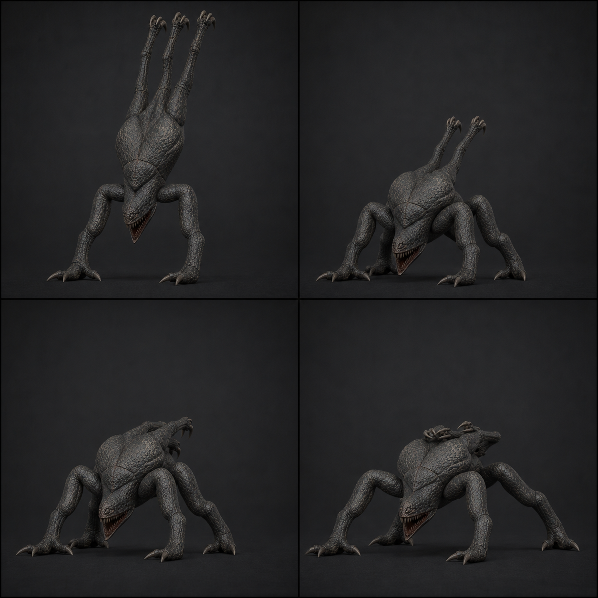

# 04 · `Clinger_Land`

상태: 2026-08-09 개정. 18f → 24f. 15f 이벤트는 그대로, 여진 구간을 붙임.

## 역할

- 24f, 30 fps, 0.80초, One-shot, in-place.
- 공격 손 2개와 뒤쪽 부착 사지 LR/RR을 바닥에 놓아 4점 자세로 바꾼다.
- 15f에 충돌체와 `NavMeshAgent`를 바꾸는 게임플레이 계약이 있다.
- **클립 전체가 지상 공간이다.** 코드가 `Land` 시작 시점에 Transform을 접점으로
  옮긴다. → [`00-rigging.md`](00-rigging.md)

## 프레임과 이벤트

| 프레임 | 접지 | 포즈 / 이벤트 |
| ---: | --- | --- |
| 1 | 없음 | 공중 자세. 손이 접지점 위 0.42 m, 몸통은 아직 낙하 형태 |
| 3 | 손 L/R | 손바닥 선접촉. 팔꿈치가 어깨 위로 튀어오름 |
| **5** | 네 점 | **충격 정점.** 등 높이 0.94 → **0.62 m**(160 mm 압축). 사지가 바깥으로 벌어지고 턱이 **44°** 열림. 손가락 −26° 젖혀짐 |
| 9 | 네 점 | 반동. 등이 정지 높이를 70 mm 넘어선다. roll 9° |
| 12 | 네 점 | 하강. LF/RF가 등 위로 회수되기 시작 |
| **15** | 네 점 | `AE_EnableGroundMode`: 지상 Capsule/Agent on. 등 0.94 m 통과 |
| 18 | 네 점 | **1차 여진.** 몸통 −24 mm, 머리가 좌우로 11° 흔들림 |
| 21 | 네 점 | **2차 여진.** 진폭 40%, 턱 8° |
| 24 | 네 점 | 지상 정지 포즈. `Scuttle` 1f 및 `Attack` 1f와 동일 |

## 왜 여진이 두 번인가

착지가 한 번에 멈추면 무게가 없다. 정점(5f) → 반동(9f) → 여진 두 번(18f, 21f)의
**감쇠하는 네 박자**가 질량을 만든다. 두 여진의 간격(3f)이 정점과 반동의
간격(4f)보다 짧아야 «잦아든다»로 읽힌다.

15f 이벤트를 정점(5f)이 아니라 회복 구간에 둔 것은 초판 그대로다. 충격 프레임에
Agent를 켜면 아직 자세가 정리되지 않은 채 이동이 시작된다.

## 제작값

- 실제 낙하 속도를 animation에 bake하지 않는다. 1f는 충돌 감지 시점의 상대 포즈다.
- 손 IK와 LR/RR IK는 3~5f 사이에 영향력 0 → 1로 올린다. 1~2f는 공중이라 0이다.
- 등 높이 압축 **160 mm**(초판 70 mm), 몸통 pitch ±16°, roll ±9°. 바닥을 뚫는
  squash는 금지 — 관통 2 mm 이하는 그대로다.
- 손가락은 접촉 순간 **−26°로 젖혀졌다가** 9f에 +18°로 움켜쥔다. 초판은 8~12°
  닫힘만 허용했는데, 젖혀지는 방향이 있어야 하중이 걸린 것으로 보인다.
- LF/RF는 12~20f에 걸쳐 등 위로 접힌다. 착지 순간에는 아직 공중에 펼쳐져 있다.

## 코드 계약

- f15에 천장 Sphere off, 지상 Capsule h 1.25 / r 0.52 / center y 0.62 on.
- 같은 프레임에 Agent r 0.55 / h 1.33을 NavMesh에 배치하고 speed는 0에서 시작한다.
- NavMesh sample 실패 시 Agent를 공중에 켜지 말고 착지 위치를 유효 지점으로 보정한다.
- Transform 이동은 `Land` **시작 시점**에 이미 끝나 있다. f15에는 하지 않는다.

## 검수

- 5f 충격이 가장 크고 15f 전에는 지상 추격이나 공격을 시작하지 않는다.
- 24f 등 높이 1.27±0.03 m, 접지 4점이 모두 바닥에 닿는다(실측 간극 1.1~4.3 mm).
- 바닥 관통 **1 mm 이하**(전 프레임).
- `Land` 24f → `Scuttle` 1f 전환에서 네 접지점 pop이 2 cm / 3° 이하다.
