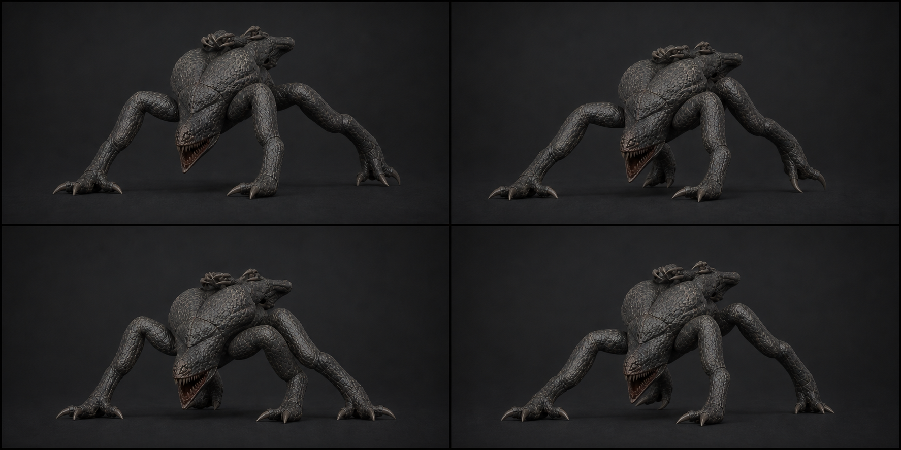

# 05 · `Clinger_Scuttle`

상태: 2026-08-09 개정. 길이 유지, 진폭 2~3배와 좌우 비대칭 강화.

## 역할

- 24f + 이음매 1f = 파일 25f, 30 fps, 0.80초, Loop, in-place.
- 공격 손 L/R을 앞발, 천장 사지 LR/RR을 뒷발로 쓰는 4점 보행.
- 최대 4.20 m/s. Crawler의 낮고 매끄러운 질주와 반대로 **절뚝이며 덜컹거려야** 한다.

## 이 걸음이 이상해야 하는 이유

앞다리(공격 팔 1.55 m)가 뒷다리(천장 사지 0.82 m)의 거의 두 배다. 정상적인 4점
보행은 나올 수 없고, 나오면 오히려 틀린 것이다. 앞팔이 몸을 **끌어당기고** 뒷사지가
따라오다 밀리는, 목발 짚는 것에 가까운 걸음으로 만든다.

## 접지표

| 프레임 | 접지 | 포즈 |
| ---: | --- | --- |
| 1 | 손L + RR | 첫 대각선 지지. 몸통 좌측 40 mm, roll −11° |
| 4 | 손L + RR | **끌기.** 왼팔이 몸을 앞으로 당긴다. 등이 110 mm 낮아짐 |
| 7 | 손R + LR | 새 대각선 touchdown. 오른손이 앞으로 0.42 m 짚는다 |
| 10 | 손R + LR | 몸통 yaw +8°, 머리는 진행 방향 유지(yaw의 60% 역보정) |
| 13 | 손R + LR | **두 번째 끌기.** 등 최저. 뒤 사지 갈고리가 바닥을 긁는다 |
| 16 | 손L + RR 준비 | 왼팔 회수 최고점 190 mm. 팔꿈치가 등 위로 올라온다 |
| 19 | 손L + RR | 첫 대각선 복귀. 좌우 **2f 비대칭**을 유지한다 |
| 22 | 손L + RR | 등 최고, roll −11° |
| 24 | — | 1f로 수렴 |
| 25 | — | 1f 복제 |

## 제작값

- 한 주기 가상 이동거리 3.36 m(4.2 m/s × 0.8 s). playback은
  `agent.velocity.magnitude / 4.2`를 0.65~1.15로 제한한다.
- 접지 IK는 Ground/World 고정. **회수 높이는 손 190 mm, 뒤 갈고리 60 mm.**
  손은 크게 들고 뒷사지는 거의 못 든다 — 이 비대칭이 절뚝임의 정체다.
- 등 상하 **110 mm**, 좌우 **40 mm**, body roll **±11°**, yaw **±8°**.
  초판은 45/40/±4°였다.
- 좌우 위상은 정확히 반주기가 **아니다.** 오른쪽 대각선이 12f가 아니라 **13f**에서
  최저를 지난다. 1f의 어긋남이 매 주기 「한쪽 발을 저는 것」으로 읽힌다.
- 공격 손가락은 접지 중 18°, 회수 중 −12°(젖힘). 손바닥 덩어리 전체가 하중을 받고
  손가락 끝으로 땅을 찌르지 않는다.
- LF/RF 천장 사지는 등 위에 접은 채 **매 주기 14°/10°씩 서로 다른 위상으로**
  경련한다. 초판은 5~8° 지연만 허용했다. 여섯 다리처럼 보이면 실패지만, 등 위에서
  꿈틀거리는 것은 다리로 안 읽힌다.
- 턱은 **12° 열린 채** 걷고 접지 충격마다 ±5° 덜컹거린다. 닫으면 검은 덩어리다.

## 검수

- 모든 프레임에 최소 두 지지점이 있고 접지 중 미끄러짐은 3 cm 이하다.
- 25f와 1f의 전 deform 본 월드 행렬 차 **0.0000 m / 0.000°**(실측).
- 정면에서 실제 보행점은 4개만 읽히고 등 위 LF/RF가 바닥에 닿지 않는다.
- 240°/s 회전과 4.2 m/s 직선 이동에서 pole flip과 주기 경계 pop이 없다.
- Crawler와 나란히 재생했을 때 두 걸음이 다른 생물로 읽힌다.
