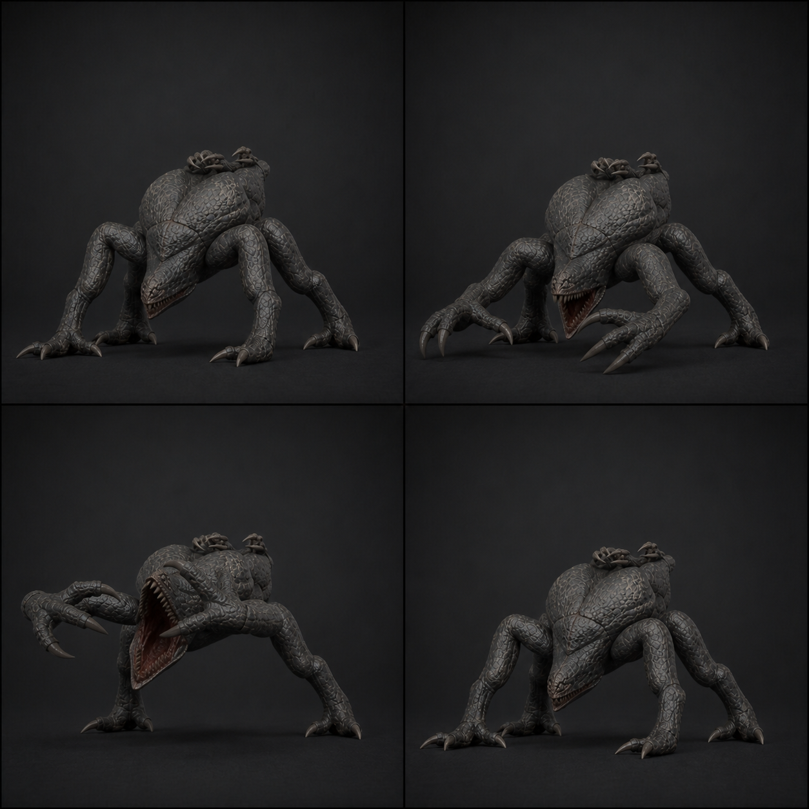

# 06 · `Clinger_Attack_Underjaw`

## 역할

- 22f, 30 fps, 0.73초, One-shot, in-place.
- 몸통 아래 쐐기 입과 양 공격 손이 동시에 닫히는 전방 압착 공격이다.
- 9f 예고, 13f 피해로 Crawler 공격과 타이밍은 같게 읽히되 더 넓은 양손 외곽을 쓴다.

## 프레임과 이벤트

| 프레임 | 단계 | 포즈 / 이벤트 |
| ---: | --- | --- |
| 1 | 진입 | GroundPose, LR/RR 접지, 손은 전방 지지 |
| 5 | 모으기 | Body 45 mm 후퇴, 양손 바깥으로 90 mm, Jaw 5° |
| **9** | **예고 정점** | TorsoTip 7° 하향, Jaw 14°, 손가락 8°, 공격 외곽 최대 |
| 11 | 발사 | LR/RR 신전, 양손이 입 양옆으로 빠르게 수렴 |
| **13** | **히트** | Jaw 36°, 양손/아래턱 `AE_AttackHit` 1회 |
| 16 | 닫힘 | Jaw 16°, 손은 바닥을 다시 찾음 |
| 19 | 회복 | 네 지점 접지, 공격 잠금 해제 가능 |
| 22 | 종료 | Land 18f/Scuttle 호환 GroundPose |

## 리깅과 키 작업

- Root 이동은 0. LR/RR은 1~16f Ground IK 고정해 두 손을 동시에 공격에 쓸 수 있게 한다.
- 양손은 좌우 1f 차이로 들어오되 피해 이벤트는 13f 한 번이다.
- 공격 손 이동은 전방 0.18 m, 좌우 각 0.09 m 이내. 팔 길이를 늘이거나 어깨가
  몸통에서 빠져 보이지 않게 한다.
- Jaw 최대 36°, DigitsGroup 최대 26°. 입과 손가락이 서로 관통하지 않는다.
- Head는 아래턱 힌지 역할만 하며 Crawler처럼 머리 전체를 들어 올리지 않는다.

## 코드 계약

- `AE_AttackHit`에서 전방 Capsule h 0.85/r 0.52 안의 유효 대상을 다시 검사한다.
- 한 공격당 한 번만 피해를 주고 19f 전 새 공격/지상 이동을 시작하지 않는다.
- 공격 재사용시간과 피해량은 아직 코드가 없으므로 이 문서에서 임의로 확정하지 않는다.

## 검수

- 9f에 피할 수 있는 넓은 예고, 13f에 가장 큰 손·턱 수렴이 보인다.
- 공격 중 본체 Capsule이 이동하지 않고 벽/플레이어를 시각적으로 지나치게 관통하지 않는다.
- Animation Event가 전환이나 낮은 프레임률에서 중복 호출되지 않는다.
