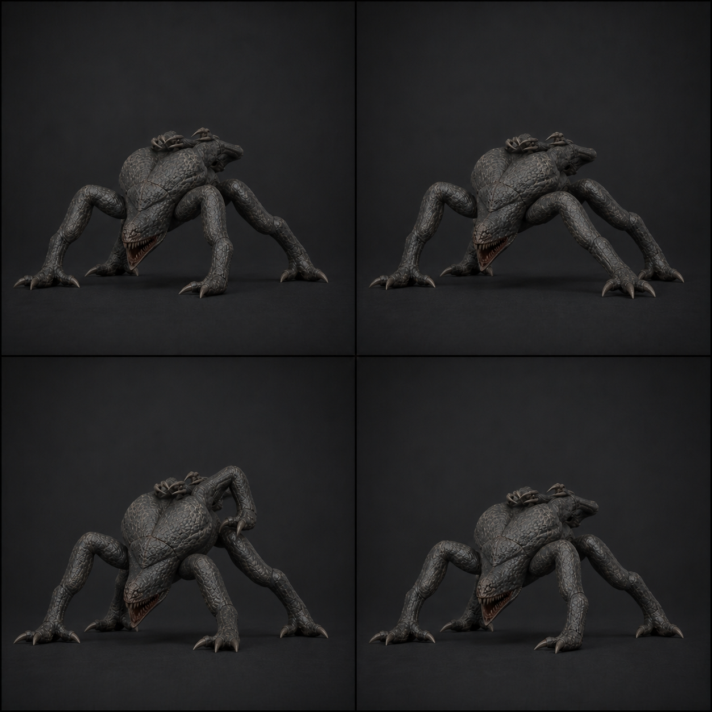

# 07 · `Clinger_Hit`

## 역할

- 10f, 30 fps, 0.33초, One-shot.
- 굵은 공격 팔 한쪽이 충격 방향으로 과회전했다 즉시 복원되는 짧은 피격이다.
- 천장 Folded와 지상 GroundPose 모두에 얹을 수 있도록 additive 기준으로 제작한다.

## 키포즈

| 프레임 | 포즈 |
| ---: | --- |
| 1 | additive 기준 0, 피격 방향으로 반응 팔 선택 |
| 3 | 선택 팔 Upper 8°/Fore 12° 과회전, Torso roll 3°, Jaw 3° |
| 5 | 반동 정점. 반대 팔과 천장/지상 지지점 유지 |
| 7 | 70% 복귀, Head가 위협 방향 재정렬 |
| 10 | additive 값 0, locomotion/Cling과 완전 호환 |

## 제작값

- 기본은 왼팔 반응으로 만들고 `HitSide`에 따라 좌우 mirror한다.
- 팔 끝 이동 90 mm, Torso 이동 25 mm, 회전 3° 이내. 공중에 뜨거나 몸통 전체가
  회전하지 않는다.
- 천장에서는 갈고리 IK 4개, 지상에서는 최소 손 1 + LR/RR 2개 접지를 유지한다.
- 1~5f 빠른 ease-out, 5~10f ease-in. 잔류 흔들림과 Noise modifier 금지.
- 치명타이면 Hit를 시작하지 않고 즉시 Death가 우선한다.

## 검수

- Folded/Scuttle 두 기준 포즈에 additive로 얹어도 관통과 공간 전환이 없다.
- 공격 예고보다 실루엣 변화가 작고 10f 뒤 원래 상태로 정확히 돌아온다.
- 연속 피격에서 Death 전환을 가리거나 늦추지 않는다.
