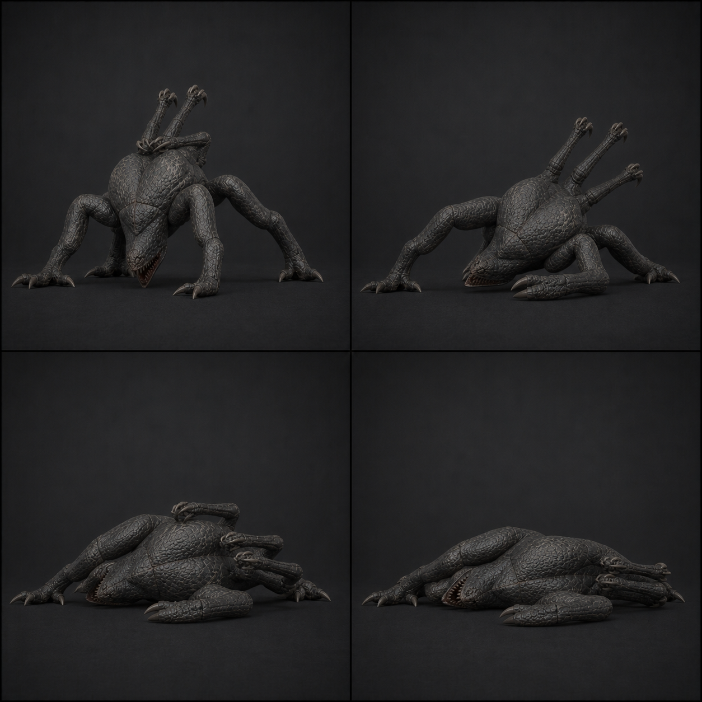

# 08 · `Clinger_Death`

## 역할

- 28f, 30 fps, 0.93초, One-shot, in-place.
- 천장에서는 갈고리가 풀리며 몸통이 옆으로 돌아 낙하하고, 지상에서는 같은 포즈로
  옆으로 주저앉는다. 실제 높이 이동과 바닥 정지는 코드가 처리한다.
- 물리 래그돌, 절단, 폭발, 과도한 뒤집힘을 사용하지 않는다.

## 프레임과 이벤트

| 프레임 | 단계 | 포즈 / 이벤트 |
| ---: | --- | --- |
| 1 | 치명타 | 현재 상태에서 공격/이동 중단, `Dead` 고정 |
| 4 | 해제 | LF→RR→RF→LR 순으로 1f씩 갈고리 장력 해제, `AE_DeathRelease` |
| 8 | 회전 | Torso roll 12°, 공격 팔 힘이 빠져 아래로 모임 |
| 14 | 붕괴 | 몸통 roll 28°, 사지 굽힘이 좌우 2~3f 어긋남 |
| 21 | 옆 자세 | Head/Jaw 6° 열린 채 한쪽 몸통 면이 아래를 향함 |
| 28 | 시체 | 모든 deform curve 정지, 코드 낙하가 끝날 때까지 같은 포즈 hold |

## 제작값

- Root 위치/회전 0. 천장 사망의 실제 하강은 `AE_DeathRelease` 뒤 코드/중력으로 처리한다.
- 갈고리는 사라지거나 부러지지 않고 장력만 순서대로 풀린다. 손가락과 공격 팔은
  Root space에서 몸통을 2~3f 늦게 따라간다.
- 몸통 roll 최대 32°, Head pitch 10°, Jaw 6°. 180° 뒤집기와 회전 누적 금지.
- 지상에서는 GroundPivot과 본체 Capsule을 즉시 끄고 렌더만 28f까지 재생한다.
- 마지막 frame의 tangent를 flat으로 하고 Cycles/Noise를 제거한다.

## 코드 계약

- `AE_DeathRelease`는 천장 Sphere/지상 Capsule/Agent를 모두 끄고 사망 낙하를 시작한다.
- 천장 높이가 커 28f 뒤에도 공중이면 마지막 시체 포즈로 계속 떨어지며,
  SphereCast가 바닥을 만나면 Transform 이동을 멈춘다.
- 시체 유지시간과 제거 시간은 아직 코드가 없으므로 구현 단계에서 확정한다.

## 검수

- 천장과 지상 두 시작 상태 모두 첫 8f 안에 사망이 명확하다.
- 여섯 사지가 서로 관통하거나 추가 다리처럼 펼쳐지지 않고 몸통 쪽으로 힘이 빠진다.
- 바닥 접촉 뒤 curve가 완전히 멈추며 collider가 플레이어와 총알을 막지 않는다.
