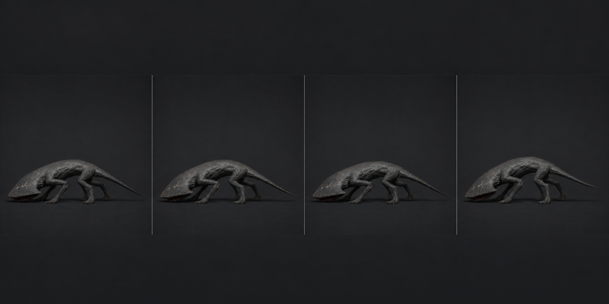

# 01 · `Crawler_Idle_Low`

## 역할

- 45f, 30 fps, 1.50초, Loop.
- 플레이어를 못 찾았거나 배회 중 잠깐 멈춘 상태다.
- 호흡하는 동물처럼 가슴을 크게 부풀리지 않는다. **등판 아래 압력이 좌우로
  천천히 이동하는 것**이 유일한 큰 변화다.

## 키포즈

| 프레임 | 포즈 |
| ---: | --- |
| 1 | Rest. 네 발 완전 접지, 머리 밑면 바닥 간격 0.12 m, 꼬리 끝 지면 접촉 |
| 12 | `SpineFront` 1.5° 좌 roll, Body 4 mm 하강, 왼쪽 관절 봉우리 압축 |
| 23 | 중앙 중립. Mouth는 완전히 닫되 입 틈은 검은 선으로 남김 |
| 34 | 1f의 반대: Spine 1.5° 우 roll, Body 4 mm 상승 |
| 46 | 1f와 같은 값. 실제 액션 범위는 1~45, 46f는 loop 확인용 복제 |

## 본과 커브

- 발 IK 네 개와 Root는 전 구간 고정한다. 발바닥 이동 허용치 2 mm.
- `CTRL_COG` Z는 총 8 mm 이하, 상하 움직임에 2차 진동을 넣지 않는다.
- `HeadPlate`는 Spine 움직임을 40%만 따라가도록 반대로 0.5~0.8° 보정해
  머리가 계속 바닥을 겨누게 한다.
- Mouth는 0~1° 미세 장력만 허용한다. 씹기나 이빨 딱딱거림은 넣지 않는다.
- 꼬리 01~04에 2/3/4/5°의 작은 지연을 주되 끝이 바닥을 뚫지 않게 한다.
- 모든 loop curve는 1f와 46f의 위치·회전·tangent가 같아야 한다. Blender에서
  Cycles modifier로 확인하고 export 전 46f 복제 키는 제외한다.

## 검수

- 64px 검정 실루엣에서 정지 이미지처럼 보이되 1.5초 비교 재생에서만 미세 이동이 읽힌다.
- 머리 최고점, 꼬리 끝, 네 발의 접지 위치가 루프 경계에서 튀지 않는다.
- Capsule 0.9 m 바깥으로 몸체가 출렁이지 않는다.
