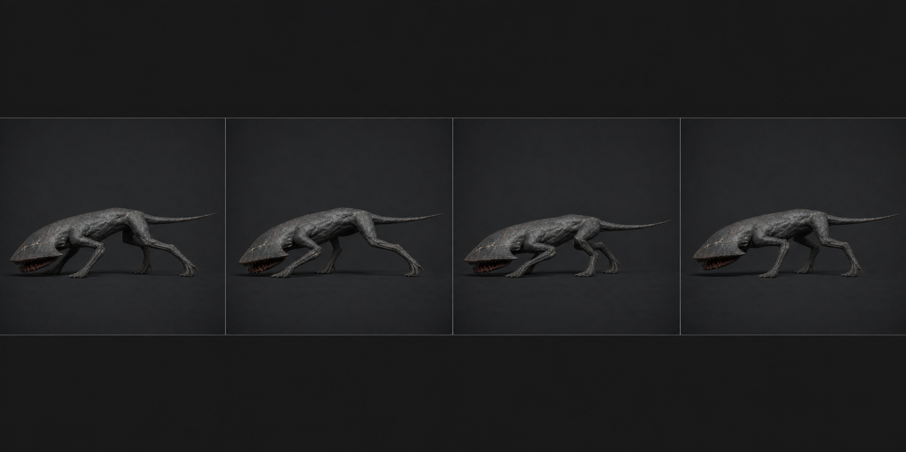

# 02 · `Crawler_Skitter`

## 역할

- 24f, 30 fps, 0.80초, Loop, in-place.
- 기획의 `배회`용 1.8~3.4 m/s 저속 이동. 현재 코드에 배회 이동은 없지만 최종
  5상태 사양과 이동 Blend Tree를 위해 만든다.
- 대각선 짝 `앞L+뒤R` / `앞R+뒤L`이 번갈아 닿는 낮은 trot이다. 곤충처럼 네 발을
  제각각 떨지 않는다.

## 접지표와 키포즈

| 프레임 | 접지 | 포즈 |
| ---: | --- | --- |
| 1 | 앞L + 뒤R | 몸통 최저, 반대 두 발은 막 떨어짐 |
| 4 | 앞L + 뒤R | 지지 중간. COG가 지지 대각선 위를 통과 |
| 7 | 앞L + 뒤R → 교대 | 반대 발이 앞으로 지나가는 passing |
| 10 | 앞R + 뒤L | 새 대각선 touchdown, 몸통 15 mm 하강 |
| 13 | 앞R + 뒤L | 두 번째 지지 중간 |
| 19 | 앞R + 뒤L → 교대 | 첫 대각선이 앞으로 회수됨 |
| 25 | 앞L + 뒤R | 1f 복제, 액션 범위는 1~24 |

## 제작값

- 한 주기 가상 이동거리는 1.9 m로 잡는다. Unity 실제 속도에 맞춘 재생률은
  `agent.velocity.magnitude / 2.375`를 기준으로 0.75~1.45 사이 clamp한다.
- 접지발은 World IK로 고정하고, 몸이 지나간 만큼 발 컨트롤을 뒤로 이동시킨다.
  in-place export라 Root 이동은 0이다.
- COG 상하폭 30 mm, 좌우폭 35 mm 이내. 몸통 pitch는 ±3°, roll은 ±2.5°.
- 앞발은 바닥에서 60 mm만 들고 앞으로 낚아챈다. 뒷발은 90 mm 들어 Z자 관절이
  접혔다 펴지는 추진을 보여준다.
- 머리는 월드 수평을 유지한다. HeadPlate 역보정은 Body pitch의 약 60%.
- 꼬리 루트는 몸통 yaw의 반대, 끝은 2~3f 늦게 따라온다. 수직으로 들지 말고
  끝부분이 지면 0~40 mm를 스치게 한다.
- 발 touchdown 앞 1f에는 감속 tangent, touchdown 프레임부터 3f는 위치를
  linear/constant에 가깝게 잡아 미끄러짐을 없앤다.

## 검수

- 어떤 프레임에도 최소 두 발이 지면에 남아 있어야 한다.
- 정면에서 좌우 발이 완전히 겹치지 않고 최대 폭 1.52 m 실루엣을 유지한다.
- Unity 2.4 m/s 시험에서 접지발 미끄러짐이 한 접지 구간당 3 cm 이하이다.
