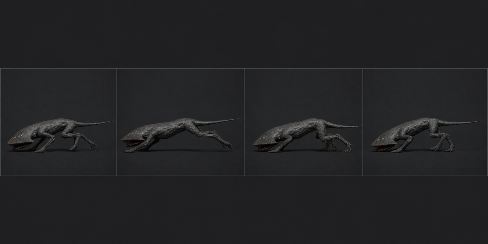

# 03 · `Crawler_Sprint`

## 역할

- 18f, 30 fps, 0.60초, Loop, in-place.
- 플레이어를 본 뒤 NavMeshAgent 최대 5.5 m/s로 추격하는 대표 동작이다.
- 완전한 공중 gallop보다 **뒷다리 압축 → 앞발 낚아채기**가 빠르게 반복되는
  지면 밀착형 질주다. 손전등 화면 아래에서 수평 쐐기가 유지되어야 한다.

## 접지표와 키포즈

| 프레임 | 접지 | 포즈 |
| ---: | --- | --- |
| 1 | 뒤L+뒤R | 뒷다리 최대 압축, 앞다리 전방 회수, 머리 최저 |
| 4 | 뒤R → 해제 | 뒷다리 완전 신전, 몸통이 전방으로 길어짐 |
| 6 | 없음 또는 앞L 직전 | 유일한 비접지 허용 구간, 최대 2f |
| 8 | 앞L+앞R | 앞발 catch, 팔꿈치가 충격 흡수, COG 35 mm 하강 |
| 12 | 앞R | 몸통이 앞발 위를 통과, 뒷다리 배 아래로 회수 |
| 15 | 뒤L+뒤R | 다음 압축 시작, 앞발 해제 |
| 19 | 뒤L+뒤R | 1f 복제, 액션 범위는 1~18 |

## 제작값

- 기준 가상 stride는 한 주기 3.30 m(5.5 m/s × 0.60 s). Unity에서는
  `agent.velocity.magnitude / 5.5`를 playback multiplier로 쓰되 0.8 이하이면
  Skitter와 blend한다.
- COG 상하폭은 55 mm 이내, 머리 밑면은 0.09 m 아래로 내려가지 않는다.
- 신전 포즈에서도 총길이 실루엣은 꼬리 포함 3.05 m를 넘기지 않는다.
- 앞발 catch 때 손목/발목을 먼저 세우고 팔꿈치가 2f 늦게 접혀 충격을 받는다.
  어깨 봉우리가 아래로 무너지지 않게 Body weight를 유지한다.
- 뒷다리 push는 좌우를 1f 어긋나게 해 기계적인 토끼뜀을 피한다.
- HeadPlate는 pitch 변화 ±4° 안. Mouth는 닫힌 채 1~2°만 흔들린다.
- 꼬리는 Skitter보다 6~10° 높지만 등선 위로 수직 상승하지 않는다. 옆에서
  수평 위협이 유지되어야 한다.

## 검수

- 5.5 m/s 직선 10 m 추격에서 발 미끄러짐이 눈에 띄지 않고 주기 경계가 튀지 않는다.
- 720°/s 방향 전환 중 IK가 뒤집히지 않는다. 회전은 clip이 아니라 Root/Agent가 한다.
- 64px 실루엣에서 몸통이 고양이처럼 위아래로 뛰거나 Clinger처럼 수직으로 보이지 않는다.
