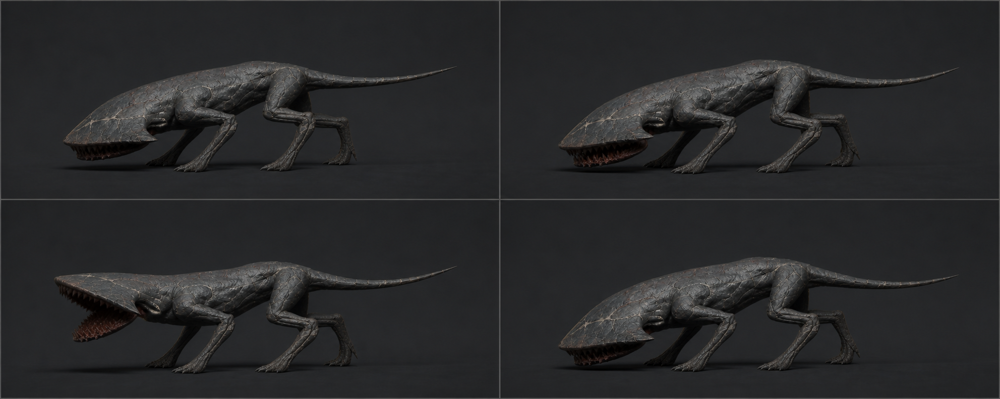

# 04 · `Crawler_Attack_Underbite`

## 역할

- 22f, 30 fps, 0.73초, One-shot, in-place.
- 머리 아래 숨은 공격구가 벌어지며 1.6 m 안의 플레이어를 아래에서 위로 물어뜯는다.
- 1인칭 화면에서 피할 수 있도록 **8f의 읽히는 예고**, 13f의 명확한 히트 포즈가 필요하다.

## 프레임과 이벤트

| 프레임 | 단계 | 포즈 / 엔진 이벤트 |
| ---: | --- | --- |
| 1 | 진입 | Sprint/Idle 현재 포즈에서 네 발 접지 고정, `AttackLock` 시작 |
| 4 | 예고 | Body 35 mm 후퇴, 앞다리 넓힘, Mouth 5°, 꼬리 낮춤 |
| 8 | 예고 정점 | 머리판 6° 하향, Mouth 12°, 붉은 안쪽이 처음 보임 |
| 11 | 발사 | 뒷다리 신전, Body 전방 80 mm, Mouth 28° |
| **13** | **히트** | Mouth 38° 최대, HeadPlate 8° 상향, `AE_AttackHit` 1회 |
| 15 | 닫힘 | 공격구 18°, 앞다리가 충격 흡수, 피해 이벤트 재발행 금지 |
| 18 | 회복 | Mouth 4°, 이동 lock 해제 가능 |
| 22 | 종료 | Idle/Sprint와 같은 낮은 중립으로 복귀 |

## 리깅과 키 작업

- Root 위치/회전은 항상 0. 실제 공격 전진은 코드/Agent가 담당한다. 시각적 80 mm
  전방 이동은 `CTRL_COG`와 다리 압축으로 만들고 마지막에 0으로 돌아온다.
- 앞발 두 개는 전 구간 World IK 접지. 4~13f에 좌우로 각각 40 mm 벌려 제동한다.
- 뒷발은 1~8f 접지, 9~14f 추진 때문에 뒤꿈치가 최대 35 mm 들려도 되며 발끝은 남긴다.
- Mouth 회전은 8~13f에서 빠르게 가속하고 13~16f에서 더 빠르게 닫는다.
  입술 vertex가 이빨을 관통하면 최대 각도를 늘리지 말고 스키닝을 수정한다.
- 공격구 안쪽만 드러나야 한다. 머리판 전체가 사람의 목처럼 들리거나 꼬리가
  찌르기 자세를 취하면 안 된다.
- 히트 포즈를 13~14f 두 프레임 유지해 30fps와 느린 Animator 재생에서도 읽히게 한다.

## 코드 계약

현재 `Crawler.Attack()`은 호출 즉시 `TakeDamage`를 실행하므로 이 클립의 13f와
맞지 않는다. Unity 연결 시 피해 적용을 `AE_AttackHit` 또는 동일한 0.433초 지연
지점으로 옮기고 다음을 검사해야 한다.

- 이벤트 시점에 대상이 살아 있고 공격 범위/시야가 유효할 때만 1회 피해.
- cooldown 1.2초는 공격 시작 시점 기준. 22f 종료 뒤 약 0.47초 재대기 시간이 남는다.
- 1~18f에는 새 공격 시작을 막고 회전 속도는 낮추되, 플레이어를 순간이동으로
  따라붙게 하지 않는다.

## 검수

- 8f 실루엣만 보고도 공격 예고가 보이고 13f에 가장 큰 형태 변화가 온다.
- Animation Event는 loop/transition 중 중복 호출되지 않는다.
- 1.6 m 경계 안팎 테스트에서 애니메이션과 피해 순간의 오차가 1프레임 이하다.
