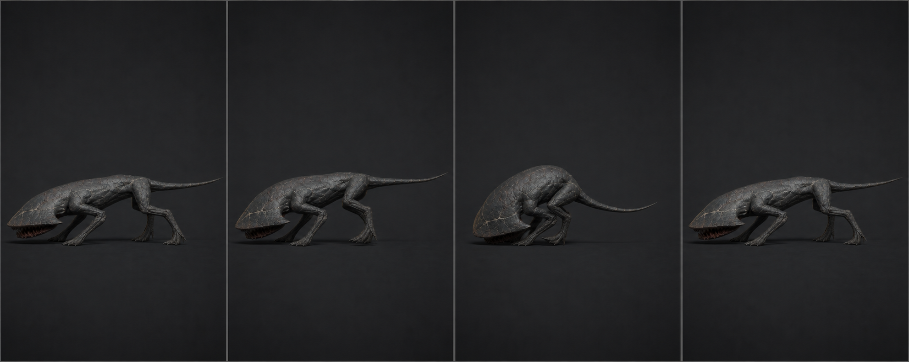

# 05 · `Crawler_Hit`

## 역할

- 12f, 30 fps, 0.40초, One-shot, in-place.
- 권총 한 발을 맞았지만 아직 살아 있을 때의 짧은 전신 피격이다. 체력이 2라서
  자주 길게 보여줄 동작이 아니며, 두 번째 치명타에는 바로 Death로 간다.
- 뒤에서 맞아도 즉시 플레이어를 추격한다는 코드 규칙을 방해하지 않는다.

## 키포즈

| 프레임 | 포즈 |
| ---: | --- |
| 1 | 현재 locomotion 포즈에서 진입. `HitDirectionLocalX` 부호 확정 |
| 3 | COG를 피격 반대쪽으로 55 mm, Spine roll 5°, Mouth 4° |
| 5 | 반동 정점. 가까운 두 다리 압축, 먼 두 발은 접지 유지, 꼬리 1f 지연 |
| 8 | 중심 복귀 70%. 머리는 플레이어 방향을 다시 겨눔 |
| 12 | Idle/Sprint 호환 중립. 추가 흔들림 없음 |

## 제작값

- 기본 액션은 오른쪽에서 맞아 왼쪽으로 밀리는 한 방향으로 만들고, Unity에서
  피격 방향에 따라 애니메이터/모델 layer를 좌우 mirror할 수 있게 좌우 비대칭을
  과하게 넣지 않는다.
- Root는 움직이지 않는다. COG 시각 이동은 최대 55 mm, 회전은 Body roll 5°,
  HeadPlate yaw 6° 이내다.
- 네 발 중 최소 두 발을 World IK 접지한다. 반동 쪽 앞/뒤 다리는 20~30 mm
  미끄러져도 되지만 바닥에서 뜨지 않는다.
- 1~5f는 빠른 ease-out, 5~12f는 긴 ease-in. overshoot를 넣지 않는다.
- Mouth는 충격으로 4°만 열고 7f에 닫는다. 공격 포즈와 혼동되지 않아야 한다.
- 이동 중에는 Full Body Override보다 0.4초짜리 override state를 쓰되
  transition 0.05초 이하로 한다. 필요하면 다리 IK constraint는 locomotion에서 유지한다.

## 코드 계약

`TakeDamage()`에서 비치명타일 때 `Hit` trigger를 보내야 한다. 권장 hit-stop은
게임 전체가 정한 경우에만 0.03~0.05초 사용하며, 이 클립만 임의로 TimeScale을 바꾸지
않는다. Agent 정지는 최대 0.15초; 이후에는 같은 클립 위에서도 추격 속도를 회복한다.

## 검수

- 피격 때문에 머리나 몸통이 Capsule 밖으로 크게 튀어 벽을 통과해 보이지 않는다.
- 두 발 연속 입력에서 첫 Hit가 Death를 가리거나 Death transition을 늦추지 않는다.
- 12f 뒤 재생 포즈가 Sprint와 섞여도 다리 pop이 5°/2 cm 이하다.
