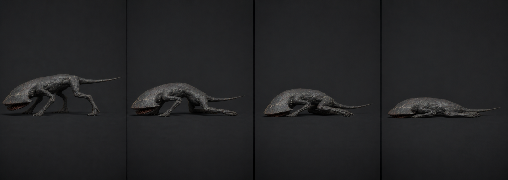

# 06 · `Crawler_Death`

## 역할

- 30f, 30 fps, 1.00초, One-shot. 마지막 30f 포즈를 시체 3초 동안 유지한다.
- 폭발적으로 튀거나 뒤집히지 않고, 네 다리가 체중을 잃어 안으로 접히며
  삽날형 머리·가슴 덩어리가 바닥에 붙는다.
- 죽은 뒤 콜라이더가 꺼지므로 물리 래그돌을 쓰지 않는다.

## 키포즈

| 프레임 | 단계 | 포즈 |
| ---: | --- | --- |
| 1 | 피격 | 현재 포즈, Mouth 3°, Agent 정지 |
| 5 | 지지 상실 | 앞L과 뒤R 관절 먼저 풀림, Body 50 mm 하강 |
| 10 | 1차 붕괴 | 앞다리 팔꿈치가 바깥 아닌 안쪽으로 접힘, 머리 밑면 접지 |
| 16 | 2차 붕괴 | 뒷다리 Z자가 배 아래로 접히고 골반이 한쪽으로 6° 기움 |
| 23 | 안착 | 몸통 전체가 바닥, Mouth 6° 열린 채 힘이 빠짐 |
| 30 | 시체 | 모든 이동 종료. 3초 유지 가능한 완전 정지 포즈 |

## 제작값

- Root 위치/회전은 0. Body/COG만 아래로 내린다. 마지막 바운드는 원래 총길이
  2.88 m와 폭 1.52 m를 크게 넘지 않아 통로를 시각적으로 막지 않는다.
- 1~10f에는 발 IK를 World로 두고 체중이 무너지는 인상을 만든다. 10~18f에
  IK/FK를 매치한 뒤 Root space로 전환해 다리가 몸 아래 자연스럽게 접히게 한다.
- 앞다리와 뒷다리를 같은 프레임에 대칭으로 접지 않는다. 좌우 2~3f,
  앞뒤 4~6f의 위상차를 둔다.
- HeadPlate는 휘지 않고 단단한 판으로 바닥에 닿는다. 접촉 이후 2° 이내의 작은
  반동 한 번만 허용한다.
- 꼬리는 3~4f 늦게 힘을 잃어 S자 한 번을 만들고 26f부터 완전 정지한다.
- 30f의 모든 F-curve tangent를 flat으로 만들고 Cycles/Noise modifier를 제거한다.
  시체 유지 중 미세 호흡이나 꼬리 흔들림은 금지한다.

## 코드 계약

현재 `Die()`는 Agent/Collider/Crawler 컴포넌트를 즉시 끄고 3초 뒤 오브젝트를
파괴한다. Animator는 별도 컴포넌트이므로 `Dead` trigger를 **컴포넌트를 끄기 전에**
보내고, `Crawler_Death`가 Unscaled Time이 아닌 정상 시간으로 끝나게 한다.
`corpseLifetime` 3초는 Death 1초를 포함하므로 최종 시체 포즈 노출 시간은 약 2초다.

## 검수

- 첫 10f 안에 사망이 명확하고 30f에 완전히 정지한다.
- 바닥 관통은 큰 면 기준 5 mm 이하, 어느 발도 위로 폭발하거나 180° 뒤집히지 않는다.
- Death 중 추가 Hit/Attack transition이 끼어들지 않고, 3초 뒤 정확히 제거된다.
