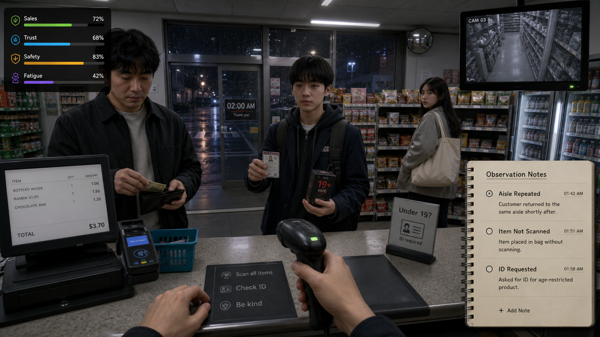

> 상태: 초안 · 최종 수정 2026-08-08

# 새벽의 편의점 — 관찰 시뮬레이션

김도한이 낸 기획안이다. **팀에서 합의된 것이 아니다.** 비교를 위해 올린 것이며,
논의를 거치기 전까지 `docs/game-design/overview.md` 에 반영하지 않는다.

IMPORTANT: 이 안은 같은 사람이 낸 [`midnight-store.md`](midnight-store.md) 로
**대체된 이전 방향**이다. 지운 것이 아니라 비교용으로 남긴다. 관찰·판별이라는
축이 다시 논의될 수 있고, 왜 갈아엎었는지가 그 자체로 판단 재료이기 때문이다.

방향을 바꾼 이유는 두 가지였다. 첫째, **재미의 중심이 절차에 있어 화면에 안
나온다.** CCTV 를 확인하고 신분증을 요청하는 것은 플레이어 머릿속에서는 긴장이지만
바깥에서 보면 정지 화면에 가깝다. 둘째, **오판을 다루는 설계가 무겁다.** 아래
11 절이 그 무게를 감당하려고 쓴 것인데, 3인이 사전 과제 기간에 감당할 분량이
아니다. 두 문제 모두 해결이 아니라 회피를 택했고, 그 결과가 리부트 안이다.

---

## 1. 게임 개요

| 항목 | 내용 |
|---|---|
| 장르 | 1인칭 편의점 운영 · 관찰 · 판단 시뮬레이션 |
| 한 줄 소개 | 야간 편의점에서 손님을 관찰하고, 필요한 순간에만 정확히 개입해 매장을 지키는 게임 |
| 플레이 시간 | 1회 근무 15~20분, 캠페인 5~7시간 |
| 분위기 | 현실적인 생활감 위에 서서히 쌓이는 불안. 공포보다 긴장과 판단을 우선 |
| 목표 | 매출, 안전, 손님 신뢰를 균형 있게 관리하며 7일간의 야간 근무를 마친다 |

## 2. 핵심 재미

1. **관찰**: 손님의 동선·행동·물건·표정을 보고 이상 신호를 포착한다.
2. **판단**: 모든 이상이 문제는 아니다. 섣불리 의심하면 선량한 손님을 잃는다.
3. **응대**: 직접 제지, 신분 확인, 도움 요청, CCTV 확인 중 맞는 대응을 고른다.
4. **결과**: 같은 사건도 대응 방식에 따라 매출·신뢰·안전·이야기가 달라진다.

## 3. 플레이 루프

```text
손님 입장 → 관찰 단서 수집 → 계산/매장 업무 병행 → 위험도 판단
→ 대응 선택 → 결과 확인 → 다음 손님과 매장 상태 변화
```

손님이 없을 때는 진열, 유통기한 확인, 청소, 발주 같은 업무를 한다. 이 업무가 단순한
대기 시간이 아니라, 손님 행동을 놓칠 위험과 맞바꾸는 선택이 되게 한다.

## 4. 주요 지표

| 지표 | 의미 | 낮거나 높을 때 |
|---|---|---|
| 매출 | 판매 성과 | 낮으면 본사 평가가 나빠짐 |
| 신뢰 | 손님의 편안함과 재방문 | 낮으면 컴플레인·악성 리뷰 증가 |
| 안전 | 절도·사고·위험 상황 관리 | 낮으면 경고, 보험료, 사건 발생 |
| 피로 | 주인공의 집중력 | 높으면 단서가 흐려지고 판단 시간이 감소 |

## 5. 관찰 시스템

### 단서의 원칙

- 하나의 행동만으로 범죄를 확정하지 않는다.
- **3개 이상의 맥락 단서**가 모였을 때 위험도가 올라간다.
- 플레이어는 손님을 클릭해 "관찰 메모"에 단서를 기록할 수 있다.
- 손님마다 불안, 급함, 수상함을 구분하는 정상적 이유가 존재한다.

### 관찰 단서 예시

| 분류 | 예시 | 가능한 해석 |
|---|---|---|
| 동선 | CCTV 사각지대를 반복 왕복 | 절도 준비 / 화장실을 찾는 중 |
| 물건 | 가방을 열고 닫으며 상품을 만짐 | 은닉 시도 / 장바구니가 없음 |
| 결제 | 소액 상품만 계산대에 올림 | 일부 상품 미결제 / 예산 부족 |
| 태도 | 계속 출입문을 확인 | 공범 신호 / 일행을 기다림 |
| 신분 | 연령 제한 상품 구매 시 신분증 미제시 | 미성년 구매 시도 / 신분증 미소지 성인 |

## 6. 핵심 사건 설계

### A. 절도 의심

손님이 에너지바와 화장품 코너를 여러 번 왕복하고, 가방이 부풀어 보인다.

- 대응: CCTV 확인 / "계산 도와드릴까요?"로 자연스럽게 접근 / 계산대에서 누락 상품
  안내 / 매니저 호출
- 좋은 설계: 잘못 의심했을 때도 모욕적 처벌보다 신뢰 하락과 사과 선택으로 이어진다.
- 성공: 증거를 확보한 뒤 차분하게 결제 또는 반환을 유도한다.

### B. 연령 제한 상품 구매 시도

젊어 보이는 손님이 담배 또는 주류를 계산대에 올린다.

- 대응: 신분증 요청 / 판매 거절 / 동료·보호자 확인 금지 안내 / 매니저 호출
- 규칙: 사진·말투가 아니라 **유효한 신분 확인 절차**를 기준으로 판단한다.
- 성공: 정중하고 일관되게 확인해 갈등을 최소화한다.

### C. 대리 구매 의심

성인이 연령 제한 상품을 구매한 뒤 매장 밖의 청소년에게 건네려는 정황이 보인다.

- 대응: 구매 전 확인 질문 / 판매 보류 / 매니저·보안 절차 호출
- 포인트: 플레이어가 법 집행자가 아니라 매장 직원이라는 한계를 지킨다.

### D. 위조 결제·환불 사기

손님이 붐비는 순간을 노려 같은 영수증으로 반복 환불을 요청한다.

- 대응: 거래 기록 대조 / 상품 상태 확인 / CCTV 시간 확인 / 관리자 승인
- 포인트: 빠른 계산 요구와 정확한 확인 사이의 압박을 만든다.

### E. 도움이 필요한 손님

불안해 보이는 손님이 매장을 맴돌고, 물건을 떨어뜨린다.

- 대응: 물 한 병 권유 / 좌석 안내 / 필요 시 보안·응급 지원 요청
- 반전: 모든 이상 행동이 '막아야 할 일'이 아니라는 게임의 핵심 사례다.

## 7. 대응 인터페이스

| 행동 | 사용 상황 | 장점 | 위험 |
|---|---|---|---|
| 지켜보기 | 단서가 부족할 때 | 오판 방지 | 사건이 진행될 수 있음 |
| 자연스러운 응대 | 의심을 드러내지 않고 확인 | 신뢰 유지 | 강한 사건에는 늦을 수 있음 |
| 신분증 요청 | 연령 확인 필요 시 | 명확한 절차 | 무례한 말투면 신뢰 하락 |
| CCTV 확인 | 증거 보강 | 정확도 상승 | 계산대·매장 시야를 비움 |
| 매니저 호출 | 위험이 높을 때 | 안전 확보 | 대응 지연·매출 손실 |
| 신고/보안 호출 | 즉각 위험 시 | 큰 피해 방지 | 오판 시 큰 신뢰 하락 |

## 8. 화면 구성 시안



| 영역 | 역할 | 플레이 감각 |
|---|---|---|
| 중앙 카운터 | 손님 결제·신분 확인·응대 선택 | 눈앞의 대화에 집중 |
| 우측 관찰 노트 | 확인된 행동 단서만 기록 | 성급한 단정 방지 |
| 우측 상단 CCTV | 계산대 시야 밖의 동선 확인 | 잠깐 시선을 비우는 긴장 |
| 좌측 상단 지표 | 매출·신뢰·안전·피로 | 모든 선택의 균형 판단 |
| 하단 행동 패널 | 스캔·신분 확인·친절 응대 | 상황에 맞는 개입 선택 |

시안에서 확정할 원칙:

- 관찰 노트는 '수상함' 같은 판정 대신 **반복 동선, 미스캔, 신분 확인 요청**처럼
  사실만 기록한다.
- 신분 확인은 연령 제한 상품에 대해 일관된 절차로만 작동한다.
- CCTV 는 강력하지만 조회 중 계산대와 손님을 놓칠 수 있다.
- 손님을 제지하는 것보다 차분히 확인하고 안전하게 보고하는 행동을 보상한다.

## 9. 하루의 구조

| 시간 | 분위기 | 주요 콘텐츠 |
|---|---|---|
| 22:00~00:00 | 퇴근길, 평온 | 기본 계산·진열·관찰 튜토리얼 |
| 00:00~02:00 | 손님 감소, 집중 필요 | 연령 확인·소규모 절도 의심 |
| 02:00~04:00 | 피로, 단서 혼선 | 환불 사기·취객·복합 사건 |
| 04:00~06:00 | 새벽의 정적 | 서사 사건·큰 선택·마감 업무 |

## 10. 캠페인 구성

| 날짜 | 새 요소 | 중심 주제 |
|---|---|---|
| 1일차 | 계산과 관찰 | 손님을 쉽게 단정하지 않기 |
| 2일차 | CCTV와 재고 | 증거를 확인하기 |
| 3일차 | 연령 확인 | 절차를 지키며 거절하기 |
| 4일차 | 공범·대리 구매 | 맥락을 읽기 |
| 5일차 | 환불 사기 | 바쁜 상황에서 정확하기 |
| 6일차 | 단골과 관계 | 신뢰와 안전의 균형 |
| 7일차 | 복합 사건 | 지금까지 배운 판단을 종합 |

## 11. 서사 방향

주인공은 야간 근무를 처음 맡은 대학생 또는 취업 준비생이다. 단골 손님, 인근 학교
학생, 택시 기사, 이웃 상인 등은 반복 등장하며 플레이어의 대응을 기억한다. 최종
사건은 '가장 수상해 보였지만 도움이 필요했던 사람'과 '가장 친절했지만 사기를 준비한
사람'을 대비해, 편견 없는 관찰의 의미를 마무리한다.

## 12. 실패와 윤리 설계

- 외모·인종·성별·장애·말투를 위험도 단서로 쓰지 않는다.
- 실제 범죄 대응을 가볍게 재현하지 않는다. 플레이어의 역할은 **확인·보고·안전
  확보**다.
- 폭력적 제압을 기본 선택지로 제공하지 않는다.
- 잘못된 의심은 손님에게 사과하고 관계를 회복할 기회를 준다.
- 안내 문구와 절차는 출시 지역의 실제 법·매장 정책 검토를 거쳐 확정한다.

## 13. 아트·사운드

- 비주얼: 한국 동네 편의점의 밝은 형광등과 유리창 밖 어두운 골목의 대비.
- 사운드: 냉장고 모터, 전자레인지, 출입문 종소리, 멀리서 나는 차량 소리.
- 긴장: BGM 대신 손님 동선, 계산대 비프음, CCTV 모니터 잡음으로 만든다.
- UI: 손님을 '위험'으로 단정하는 색상 대신, 메모와 확인된 사실을 분리해 보여 준다.

## 14. 버티컬 슬라이스 제안

20분짜리 한 번의 근무를 만든다. 구현 사건은 **절도 의심 1건, 연령 확인 1건, 도움이
필요한 손님 1건**으로 제한한다. 플레이테스트에서 "무작정 의심하지 않고 단서를
모았는가"와 "절차가 지루하지 않았는가"를 확인한다.

## 15. 다음 제작 순서

1. 계산대·진열대·CCTV가 보이는 작은 매장 한 곳을 만든다.
2. 손님 행동 상태(입장/탐색/계산/이탈)와 관찰 메모를 구현한다.
3. 사건 3개와 대응 4개를 연결한다.
4. 신뢰·안전 지표 및 결과 화면을 만든다.
5. 5명 이상 플레이테스트 후 오판 빈도와 지루한 구간을 조정한다.

---

## 이 저장소에 옮기며 붙인 메모

원본은 저장소 밖 `Mutual_공포게임_기획서/` 의 `편의점_관찰시뮬레이션_기획서.md`
와 `편의점_게임시안_설명.md` 두 파일이다. 후자가 전자의 화면 시안 설명이라 8 절로
합쳤고, 나머지 본문은 그대로 옮겼다. 절 번호는 그만큼 뒤로 밀렸다.
