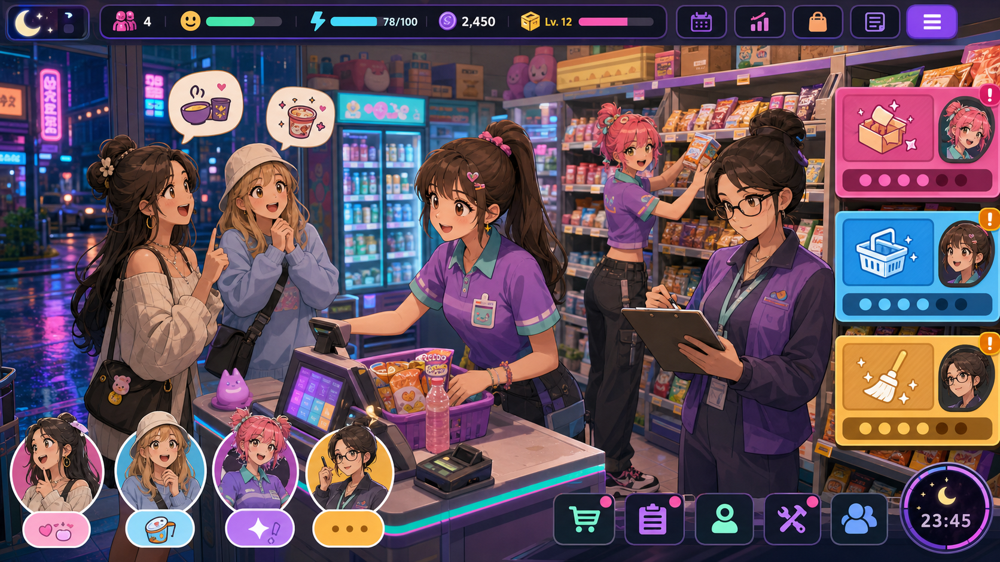
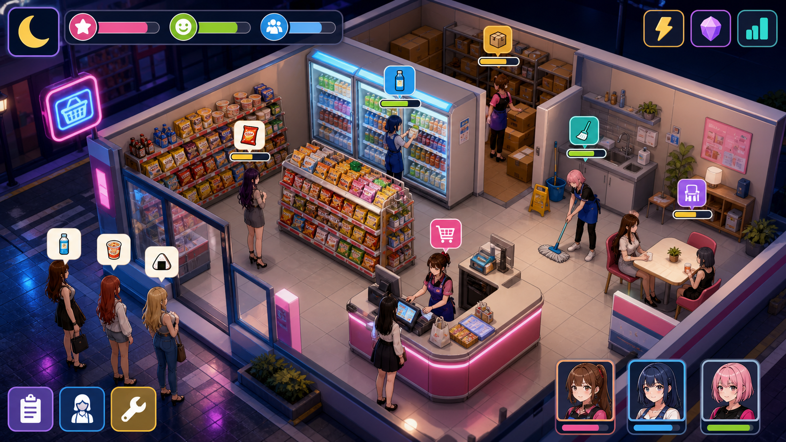
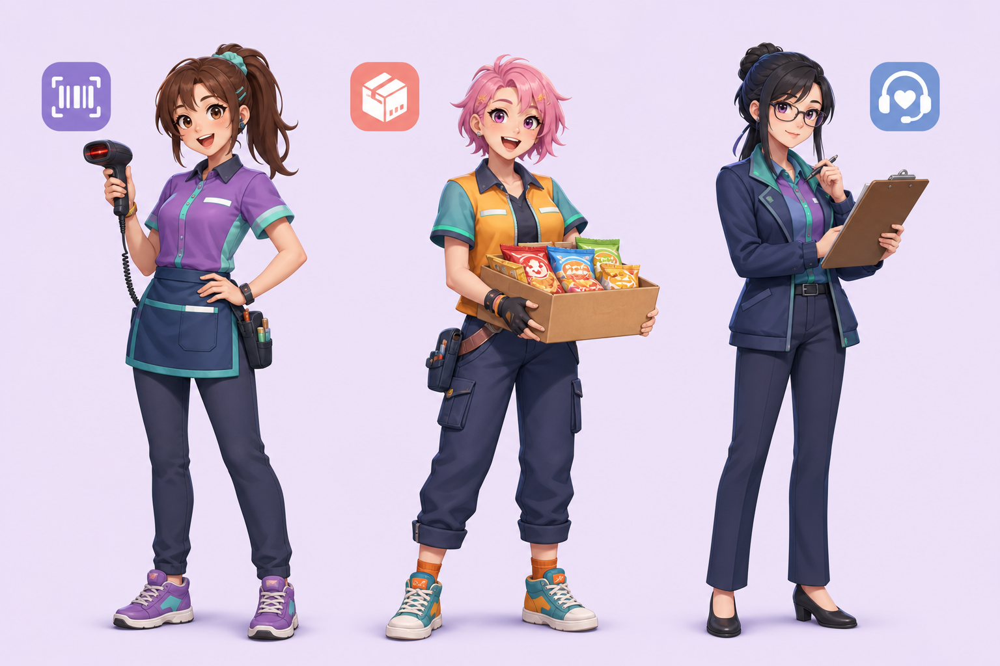
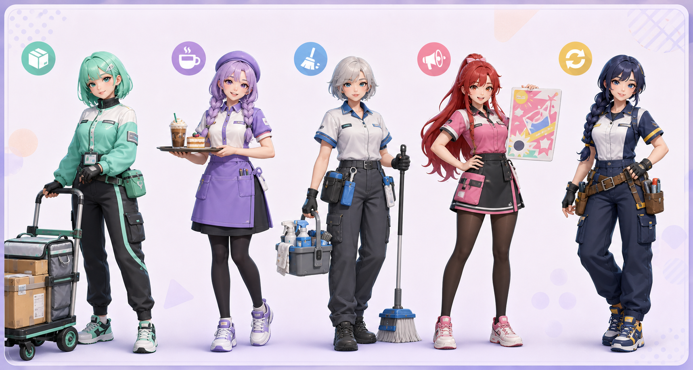
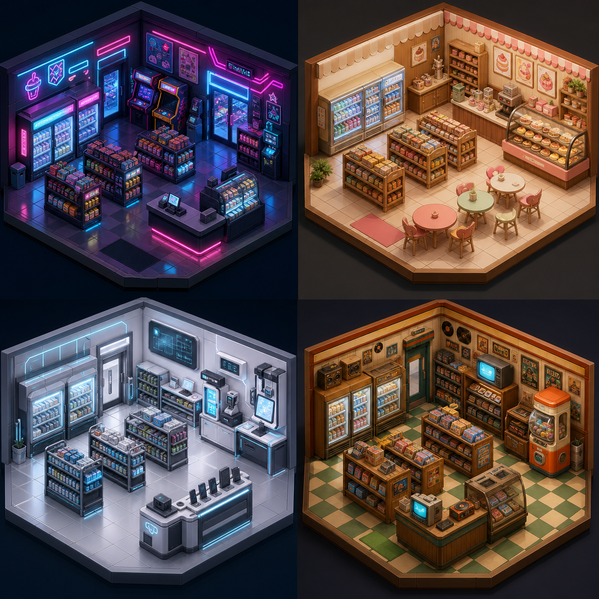

> 상태: 초안 · 최종 수정 2026-08-08

# 오늘도 오픈! 미드나잇 편의점

김도한이 낸 기획안이다. **팀에서 합의된 것이 아니다.** 비교를 위해 올린 것이며,
논의를 거치기 전까지 `docs/game-design/overview.md` 에 반영하지 않는다.

같은 편의점 소재로 먼저 쓴 [`dawn-store.md`](dawn-store.md)(관찰 시뮬레이션)를
방향 전환해 다시 쓴 안이다. 두 안은 매장 하나만 공유할 뿐 장르도 시점도 다르므로,
둘 중 하나를 고르는 것으로 본다. 왜 갈아엎었는지는 그쪽 문서에 적어두었다.



---

## 게임 한 줄 소개

개성 넘치는 성인 미소녀 직원 3명을 배치해, 매일 찾아오는 성인 미소녀 손님들의
황당한 요청과 돌발 이벤트를 해결하는 캐주얼 편의점 운영 시뮬레이션.

## 한눈에 보는 매장 운영



플레이어는 위에서 매장 전체를 보며 직원 카드를 필요한 구역으로 이동시킨다. 카운터
혼잡, 냉장고 재고, 청소, 손님 휴식 요청이 동시에 생겨 우선순위 판단이 핵심이 된다.

## 톤 전환

| 이전 방향 | 리부트 방향 |
|---|---|
| 관찰·판별·긴장 | 팀워크·우선순위·좌충우돌 코미디 |
| 사실적인 편의점 | 네온과 파스텔이 섞인 스타일라이즈드 3D |
| 범죄 대응 중심 | 단골 사연·매장 운영·이벤트 해결 중심 |
| 1인칭 | 캐릭터를 배치하고 지시하는 탑다운/쿼터뷰 |

## 핵심 루프

```text
손님 주문 등장 → 직원 배치 → 계산·진열·청소·특수 요청 처리
→ 콤보와 단골 만족도 획득 → 매장 업그레이드 → 다음 야간 이벤트
```

## 직원 3인



| 이름 | 역할 | 고유 스킬 | 성격 |
|---|---|---|---|
| 유나 | 계산대 에이스 | 3명 동시 결제 '초고속 스캔' | 밝고 덜렁댐 |
| 루미 | 진열 담당 | 한 구역 재고 즉시 정리 '컬러 매칭' | 에너지 넘침 |
| 세라 | 야간 매니저 | 손님 불만을 만족도로 전환 '한 잔의 위로' | 침착한 현실파 |

## 기본 캐릭터와 해금 캐릭터



처음에는 유나·루미·세라 3명을 기본 제공한다. 플레이어는 근무 조합에 따라 2명을
출근시키고, 나머지 한 명은 휴식·연수·개인 이벤트를 진행한다.

| 해금 캐릭터 | 해금 조건 | 역할 | 고유 스킬 |
|---|---|---|---|
| 민트 | 단골 만족도 20 달성 | 배달·발주 | '초특급 배송': 입고 대기 시간 제거 |
| 하린 | 디저트 코너 2단계 | 제조·카페 | '라테 아트': 카페 주문 만족도 2배 |
| 노아 | 야간 매출 목표 3회 | 청소·정비 | '정리의 마법': 청결도 즉시 최대 |
| 다온 | 이벤트 스토리 1장 완료 | 홍보·응대 | '오늘의 추천': 손님 3명의 추가 구매 유도 |
| 지아 | 모든 기본 캐릭터 호감도 5 | 만능 서포트 | '체인지 오버': 두 직원의 위치를 즉시 교체 |

해금 캐릭터는 단순히 능력치가 높은 직원이 아니라, 잘하는 업무·약한 업무·선호하는
인테리어가 달라 팀 조합의 이유를 만든다.

## 손님과 이벤트

모든 손님은 성인 미소녀 캐릭터이며, 같은 손님이 단골로 다시 방문해 관계가 이어진다.

| 손님 유형 | 요청 | 재미 포인트 |
|---|---|---|
| 마감 직전 작가 | 특정 색 간식 5개 | 재고를 빠르게 조합하는 퍼즐 |
| 아이돌 연습생 | 칼로리 균형 도시락 | 제한 시간 조합 주문 |
| 밤샘 개발자 | 커피·충전기·감기약 | 동시 요청 우선순위 |
| 길 잃은 여행자 | 지역 한정 상품 | 매장 업그레이드로 해금되는 진열 |
| 경쟁 점주 | 할인 대결 | 가격표·진열·서비스의 미니게임 |

## 조작과 승리 조건

- 직원 카드를 드래그해 업무에 배치하고, 스킬은 게이지가 찼을 때 사용한다.
- 주문을 연속으로 정확히 해결하면 '친절 콤보'가 쌓여 팁과 평판이 오른다.
- 매일 **매출·매장 청결·단골 만족도** 목표 중 둘 이상을 달성하면 성공이다.
- 실패해도 하루를 다시 하기보다, 다음 날의 난이도나 단골 대화가 변한다.

## 성장 요소

| 성장 | 효과 |
|---|---|
| 매장 꾸미기 | 간판·카운터·휴식 공간으로 손님 유형과 버프 변화 |
| 상품 해금 | 디저트, 지역 한정, 즉석식 등 주문 조합 확장 |
| 직원 호감도 | 콤비 스킬과 개인 에피소드 해금 |
| 단골 앨범 | 손님 사연을 완성하고 엔딩 분기 해금 |

## 인테리어 시스템



인테리어는 꾸미기만 하는 기능이 아니라 **손님 구성, 주문 종류, 운영 버프**를 바꾸는
전략 시스템이다. 가구는 자유 배치보다 '테마 슬롯' 방식으로 시작해 제작 난이도를
낮춘다.

| 테마 | 주요 장식 | 운영 효과 | 찾아오는 손님 |
|---|---|---|---|
| 네온 나이트 | 네온 간판, 아케이드, LED 냉장고 | 야간 매출 +10%, 피로 +5% | 밤샘러, 댄서, 스트리머 |
| 포근한 디저트 | 우드 선반, 파스텔 테이블, 디저트 진열 | 카페 주문 만족도 +20% | 작가, 학생, 데이트 손님 |
| 미니멀 랩 | 메탈 선반, 충전 스테이션, 셀프 계산대 | 계산 속도 +15%, 청소 난도 +1 | 개발자, 게이머, 여행자 |
| 레트로 코너 | CRT, 뽑기 기계, 카세트 진열 | 희귀 단골 출현율 +15% | 수집가, 밴드 멤버, 점주 라이벌 |

### 인테리어 진행 방식

1. 하루 매출과 이벤트 보상으로 '스타 코인'을 얻는다.
2. 테마 가구를 구매해 카운터·진열·휴식·외관 슬롯에 장착한다.
3. 같은 테마 장식을 3개 이상 맞추면 세트 버프가 발동한다.
4. 단골의 선호 테마에 맞추면 개인 에피소드와 전용 상품이 열린다.

## 첫 20분 버티컬 슬라이스

유나·루미·세라, 손님 5명, 주문 3종, 마감 직전 혼잡 이벤트 하나만 구현한다. 여기에
네온 간판 1개와 디저트 진열대 1개를 넣어, 인테리어가 주문·손님에 영향을 주는지
검증한다. 목표는 '누가 더 바쁜가'를 빠르게 판단하고 캐릭터 스킬을 쓰는 재미를
검증하는 것.

## 비주얼 원칙

- 실사 대신 셀 셰이딩 기반의 선명한 색·과장된 리액션·큰 UI 아이콘을 사용한다.
- 코스튬은 실용적인 유니폼을 기본으로 하고, 장식은 캐릭터성을 드러내는 선에서
  제한한다.
- 브랜드·실제 편의점 로고는 쓰지 않고, 독자적인 가상 매장명과 상품 디자인을 만든다.

---

## 이 저장소에 옮기며 붙인 메모

원본은 저장소 밖 `Mutual_공포게임_기획서/편의점_서브컬처_리부트_기획서.md` 이고,
본문은 그대로 옮겼다. 이미지는 파일명만 ASCII 로 바꿔 같은 폴더에 두었다.

논의 전에 짚어둘 것 세 가지.

- **캐릭터 에셋이 최대 리스크다.** 직원 3명 + 해금 5명 + 손님 유형 5종이면 셀
  셰이딩 캐릭터가 최소 13종이고, 3인이 사전 과제 기간에 만들 규모가 아니다. 위
  버티컬 슬라이스가 직원 3명·손님 5명으로 이미 줄여둔 것은 맞지만, 그래도
  **컷라인을 더 내려야 한다.** 에셋스토어에서 조달 가능한지가 채택 여부를 가른다.
- **60초 영상에 무엇이 남는지 아직 안 정했다.** 제출물의 핵심이 영상이므로,
  탑다운 화면에서 카드를 옮기는 그림이 60초를 버티는지 먼저 확인해야 한다.
- **폴더 이름이 '공포게임'인 것은 초기 흔적이다.** 이 안은 공포가 아니다.
