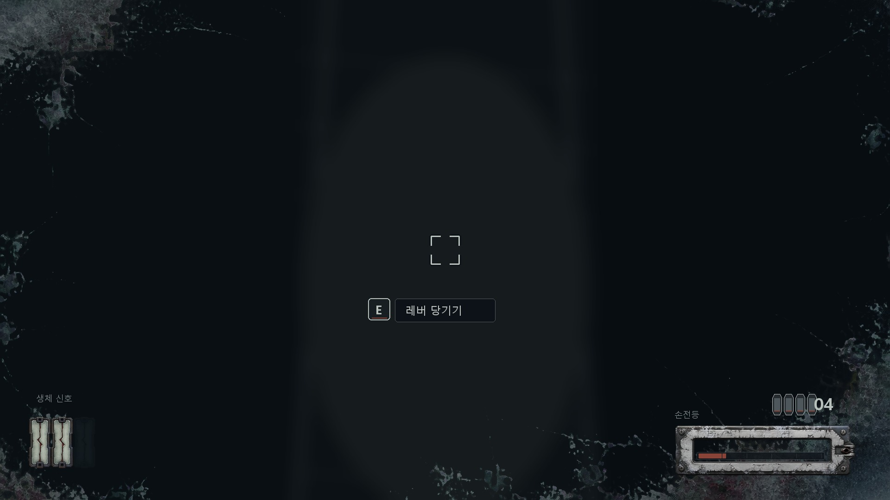
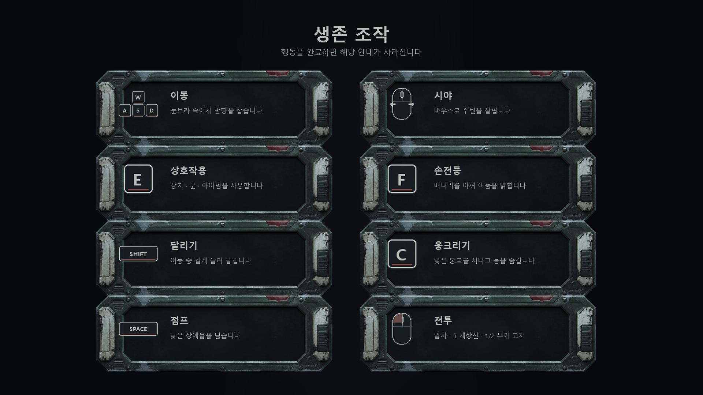

# Treeline UI 에셋

> 상태: HUD 13개 연결 완료, 메뉴 · 튜토리얼 미연결 · 최종 수정 2026-08-08

확정 기획 [`../game-design/treeline.md`](../game-design/treeline.md)과 적 모델링의
`Frost-pressure anatomy` 규격을 바탕으로 만든 Unity UI 시안이다. 런타임 PNG는
[`Treeline/Assets/Game/UI/Art`](../../Treeline/Assets/Game/UI/Art)에 Sprite로
임포트했다. HUD 13개는 `Player.prefab` 의 `HUD` 캔버스에 붙였고(A 이정범), 메뉴와
튜토리얼은 아직 붙이지 않았다. 크기와 대비는 에디터 플레이 모드에서만 봤으므로
1920×1080 WebGL 빌드에서 다시 확인해야 한다.





## 아트 디렉션

핵심 문장은 **중계소 계기판 + 동결압 균열**이다.

- 기본 골격은 오래된 통신 중계소의 차가운 강철, 깨진 법랑, 퓨즈와 계기판에서
  가져온다.
- 크리처와의 연결은 검푸른 면, 서리 흉터, 중앙 압력 균열, 3% 이하의 멍든 적색만
  사용한다. 생물 피부를 HUD 프레임으로 직접 복제하지 않는다.
- 공포는 장식보다 정보의 부재에서 만든다. 체력·탄약·배터리를 늘 켜 두지 않고
  해당 정보가 변하거나 위험할 때만 불투명도를 올린다.
- 텍스트는 이미지에 굽지 않는다. TextMeshPro로 올려 한국어 교체와 해상도 대응을
  유지한다.

적 시트의 세 실루엣은 HUD에도 간접 반영했다. Crawler의 낮은 수평선은 배터리와
버튼, Clinger의 가는 수직 균열은 체력 칸, Colossus의 닫힌 문은 큰 패널 프레임의
형태 언어로 옮겼다.

## R&D에서 가져온 원칙

- *Dead Space*의 몰입형 UI처럼 화면 위 정보가 세계의 재질과 동떨어지지 않게 한다.
  다만 Treeline은 플레이어 수트가 없으므로 완전한 다이에제틱 UI를 흉내 내지 않고,
  중계소 하드웨어의 조형만 비다이에제틱 HUD에 빌린다.
- *Alien: Isolation*의 아날로그 장비·저해상도 디스플레이 계열은 분위기 참고만 하고,
  녹색 CRT·SF 기호·복고 우주선 레이아웃은 사용하지 않는다.
- Unity의 9-slice를 사용해 모서리 디테일을 유지하면서 패널과 버튼 폭을 바꾼다.

참고 링크: [EA의 Dead Space UI 인터뷰](https://www.ea.com/news/breaking-into-the-industry-dino-ignacio-ui-lead-at-visceral-games),
[Alien: Isolation 디자인 발표 정리](https://www.avpgalaxy.net/games/alien-isolation/develop-audience-alien-isolation-report/),
[Unity 9-slice 매뉴얼](https://docs.unity.cn/Manual/9SliceSprites.html).
외부 이미지를 복사하거나 포함하지 않았고, 결과물은 이미지 생성 후 로컬에서
재가공했다.

## 폴더

| 경로 | 내용 |
| --- | --- |
| `runtime/` | Unity에 복사할 용도별 투명 PNG |
| `masters/alpha/` | 후처리된 고해상도 알파 마스터 |
| `masters/chroma/` | 이미지 생성 직후의 크로마 키 원본 |
| `previews/` | HUD·타이틀 배치 시안과 에셋 연락판 |
| `tools/build_assets.py` | 크기 변환, 상태 변형, 프리뷰 재생성 |
| `generation-prompts.md` | 생성에 사용한 최종 프롬프트 |

## Unity 프로젝트 배치

`runtime/`이 제작 기준 원본이고 Unity에는 아래와 같이 복사했다.

```text
Assets/Game/UI/Art/
├─ Menu/
├─ Tutorial/
├─ HUD/
│  ├─ Vitals/
│  ├─ Flashlight/
│  ├─ Stamina/
│  ├─ Combat/
│  └─ Interaction/
└─ Effects/
```

27개 PNG 모두 `Sprite (2D and UI)`, Single, Full Rect, sRGB, Alpha Is
Transparency on, Mip Maps off, Bilinear, Clamp로 임포트했다. 작은 조준점·키캡·게이지
채움은 비압축, 큰 프레임·체력·피격 오버레이는 High Quality 압축이다. 패널과
버튼의 9-slice Border도 아래 표의 값으로 `.meta`에 저장했다.

## 런타임 에셋

| 파일 | 크기 | 용도 |
| --- | ---: | --- |
| `runtime/menu/panel-frame-9slice.png` | 1024×603 | 타이틀·설정·사망 패널 |
| `runtime/menu/button-frame-9slice.png` | 768×155 | 시작·설정·종료 버튼, 상호작용 문구 배경 |
| `runtime/menu/menu-divider.png` | 512×16 | 타이틀·설정 구분선 |
| `runtime/hud/vitals/health-pip-active.png` | 96×225 | 체력 1칸. 3개를 나란히 배치 |
| `runtime/hud/vitals/health-pip-empty.png` | 96×225 | 잃은 체력 1칸 |
| `runtime/hud/flashlight/battery-frame.png` | 512×145 | 손전등 배터리 외곽 |
| `runtime/hud/flashlight/battery-fill-full.png` | 384×32 | 배터리 정상 채움. Image `Filled`로 사용 |
| `runtime/hud/flashlight/battery-fill-low.png` | 384×32 | 25% 이하 경고 상태 |
| `runtime/hud/stamina/stamina-frame.png` | 512×91 | 달리기 스태미너 외곽 |
| `runtime/hud/stamina/stamina-fill-ready.png` | 384×24 | 소모·회복 중 기본 채움 |
| `runtime/hud/stamina/stamina-fill-recovery-locked.png` | 384×24 | 달리기 직후 회복 대기 상태 |
| `runtime/hud/combat/ammo-round.png` | 28×52 | 현재 무기의 탄약 눈금 |
| `runtime/hud/combat/crosshair.png` | 64×64 | 기본 사격 조준점 |
| `runtime/hud/interaction/interact-reticle.png` | 96×96 | 상호작용 가능한 물체 조준 표시 |
| `runtime/hud/interaction/keycap-e.png` | 56×56 | 키보드 상호작용 키캡 |
| `runtime/effects/damage-overlay.png` | 1672×941 | 피격 시 짧게 나타나는 화면 가장자리 균열 |
| `runtime/tutorial/tutorial-card-frame.png` | 768×254 | 단계별 안내 카드 배경. TextMeshPro 문구를 별도로 배치 |
| `runtime/tutorial/keycap-wasd.png` | 176×116 | 이동 안내 |
| `runtime/tutorial/mouse-look.png` | 72×96 | 시야 회전 안내 |
| `runtime/tutorial/mouse-left-click.png` | 72×96 | 공격 안내 |
| `runtime/tutorial/keycap-shift.png` | 128×56 | 달리기 안내 |
| `runtime/tutorial/keycap-space.png` | 144×56 | 점프 안내 |
| `runtime/tutorial/keycap-e.png` | 56×56 | 상호작용 안내 |
| `runtime/tutorial/keycap-f.png` | 56×56 | 손전등 안내 |
| `runtime/tutorial/keycap-c.png` | 56×56 | 웅크리기 안내 |
| `runtime/tutorial/keycap-r.png` | 56×56 | 재장전 안내 |
| `runtime/tutorial/keycap-1-2.png` | 120×56 | 무기 교체 안내 |

`masters/alpha/`의 파일은 재가공용 고해상도 마스터다. Unity에는 `runtime/`
폴더만 먼저 넣는다.

## HUD 동작 제안

| 정보 | 평상시 | 강조 조건 |
| --- | --- | --- |
| 체력 3칸 | 좌하단 45% alpha | 피격 후 2초간 100%, 소진 칸은 어둡게 유지 |
| 탄약 | 무기를 들었을 때만 65% | 4발 이하 적색 선, 0발이면 0.15초 점멸 2회 |
| 배터리 | 손전등이 켜졌을 때만 55% | 25% 이하 적색 채움, 10% 이하 느린 점멸 |
| 스태미너 | 달리기 시작부터 표시, 가득 차면 1초 뒤 숨김 | 회복 대기 동안 `recovery-locked` 색, 0이면 2회 짧게 점멸 |
| 조준점 | 35% alpha | 상호작용 대상이면 `interact-reticle`로 교체 |
| 상호작용 | 미표시 | `PlayerInteractor.Prompt`가 비어 있지 않을 때만 키캡+동사 |
| 피격 | 미표시 | `PlayerHealth.HealthChanged`에서 0.35초 등장 후 1.2초 페이드 |

목표 문구와 미니맵은 만들지 않는다. 기획상 목적이 장소와 장치의 사슬로 전달되고,
항상 떠 있는 안내문은 어둠과 고립감을 약하게 만든다.

구현하면서 두 곳이 위 표에서 벗어났다(A 이정범). **스태미너와 배터리는 늘 띄우고**,
평상시 불투명도는 45~65%가 아니라 **75~85%로 올렸다.** 둘 다 쓰는 동안이 아니라
쓸지 말지를 정할 때 필요한 값이고, 낮은 불투명도는 실제 화면에서 안 보였다. 근거는
[`../tech-design/decisions.md`](../tech-design/decisions.md)에 남겼다. 배치는 이
문서의 시안을 따라 스태미너·체력은 좌하단, 배터리·탄약은 우하단이다.

## 튜토리얼 UI 동작 제안

첫 플레이에서는 큰 조작표를 계속 띄우지 않고 아래 순서의 카드를 한 장씩 보여준다.
해당 입력을 실제로 수행하면 0.2초 페이드로 사라지고 다음 단계로 넘어간다.

1. `WASD` 이동 → 마우스 시야 회전
2. `E` 상호작용 → `F` 손전등
3. `Shift` 달리기 → `C` 웅크리기 → `Space` 점프
4. 무기를 얻은 뒤에만 마우스 왼쪽 발사 → `R` 재장전 → `1/2` 무기 교체

조작표 전체 화면은 일시정지 메뉴의 `조작법`에서 다시 열 수 있게 한다. 전투 안내는
무기를 얻기 전에 노출하지 않고, 각 단계 완료 여부는 세이브 데이터에 저장해 재접속할
때 반복하지 않는다. 이미지에 설명 문구를 굽지 않았으므로 카드 제목과 설명은
TextMeshPro로 구성하고, 실제 Input System 바인딩이 바뀌면 아이콘과 문구도 함께
바꾼다.

## 구현 요청 — A 이정범

담당은 **A 이정범(플레이어 · 전투 · 진행 UI)**이다. `PlayerMotor`의 기존 달리기에
아래 스태미너 규칙을 붙이고, 이 폴더의 세 Sprite를 HUD에 연결한다.

- 앞으로 이동하며 실제로 달리는 동안만 스태미너가 초당 감소한다. Shift를 누른 채
  제자리거나 웅크린 상태면 소모하지 않는다.
- 달리기를 멈춘 순간부터 `recoveryDelaySeconds` 동안은 회복하지 않는다. 이때 HUD
  채움은 `stamina-fill-recovery-locked.png`를 사용한다.
- 대기가 끝나면 초당 `recoveryPerSecond`로 회복하고, 가득 차면 HUD를 1초 뒤 숨긴다.
- 0이 되면 즉시 걷기로 전환한다. 짧은 Shift 연타를 막기 위해 20% 이상 회복한 뒤
  다시 달릴 수 있게 한다.
- 초기 튜닝값은 **연속 달리기 5초 / 회복 대기 1.5초 / 빈 상태에서 완전 회복 3초**.
  `SerializeField`로 노출해 2장과 6장 도망 구간 플레이테스트 후 조절한다.
- UI가 매 프레임 `PlayerMotor`를 탐색하지 않도록 0~1 비율 이벤트와 회복 대기 상태를
  노출한다. 기존 `IsSprinting`은 실제로 달리는 동안에만 true를 유지한다.

완료 기준은 달리는 동안 감소, 1.5초 회복 정지, 이후 회복, 0에서 강제 걷기,
20% 재개 제한, 세 HUD 상태 전환이 A의 샌드박스에서 모두 보이는 것이다.

## Unity 임포트

공통 권장값:

- Texture Type: `Sprite (2D and UI)`
- Sprite Mode: `Single`
- sRGB: on
- Alpha Source: `Input Texture Alpha`, Alpha Is Transparency: on
- Mesh Type: `Full Rect`
- Generate Mip Maps: off
- Filter Mode: `Bilinear`
- Wrap Mode: `Clamp`
- Compression: `High Quality`; 작은 선이 뭉개지면 해당 파일만 `None`

9-slice Sprite Border 제안값:

| 파일 | Left | Bottom | Right | Top |
| --- | ---: | ---: | ---: | ---: |
| `panel-frame-9slice.png` | 112 | 96 | 112 | 96 |
| `button-frame-9slice.png` | 64 | 48 | 64 | 48 |

UGUI Canvas Scaler는 `Scale With Screen Size`, Reference Resolution은
`1920×1080`, Match는 `0.5`로 시작한다. 프레임 Image Type은 `Sliced`로 두고,
화면 가장자리 HUD는 Safe Area에서 최소 56px 안쪽에 배치한다.

`damage-overlay.png`는 화면 전체에 늘리되 원본 비율이 16:9라 종횡비가 크게 다른
화면에서는 `AspectRatioFitter`의 `Envelope Parent` 또는 중앙 크롭을 사용한다.
기본 alpha는 0이며 피격 순간에도 0.45를 넘기지 않는다.

## 재생성

Pillow 9.5 이상이 있는 환경에서 다음을 실행한다.

```powershell
python docs/ui-assets/tools/build_assets.py
```

스크립트는 알파 마스터를 덮어쓰지 않고 런타임 크기·상태 변형·프리뷰만 다시 만든다.
생성 원본을 바꾸려면 [`generation-prompts.md`](generation-prompts.md)의 프롬프트로
새 버전을 만든 뒤, 크로마 제거본을 `masters/alpha/`의 마스터 파일명에 맞춰 둔다.

## 프리뷰

- [`previews/hud-mockup-1920x1080.jpg`](previews/hud-mockup-1920x1080.jpg)
- [`previews/title-menu-mockup-1920x1080.jpg`](previews/title-menu-mockup-1920x1080.jpg)
- [`previews/tutorial-controls-mockup-1920x1080.jpg`](previews/tutorial-controls-mockup-1920x1080.jpg)
- [`previews/asset-contact-sheet.jpg`](previews/asset-contact-sheet.jpg)

프리뷰의 어두운 복도 배경은 배치 확인용으로 스크립트가 만든 임시 이미지이며 게임
에셋이 아니다.
