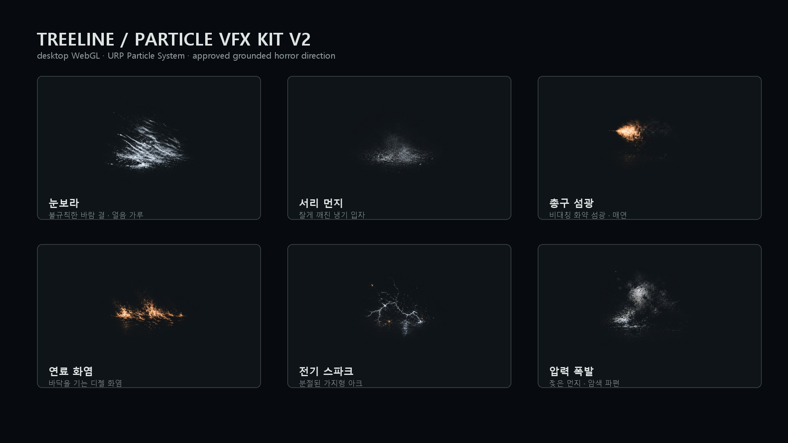

# Treeline 파티클 VFX 키트

> 상태: 승인된 V2 아트 방향으로 전체 교체 · 2026-08-09

확정 기획의 「불 · 눈 · 연기는 시뮬레이션하지 않고 파티클과 데칼로 만든다」를
바로 구현할 수 있도록 공용 텍스처와 프리팹으로 묶었다. 모바일 대응용 저사양
변형은 만들지 않았지만, 심사자가 브라우저에서 실행하므로 반투명 오버드로우와
동시 파티클 수는 제한한다.



## 폴더

```text
docs/vfx-assets/
├─ v2/               승인된 아트 방향 시트와 생성 기록
├─ masters/chroma/   공유·재가공용 크로마 마스터
├─ masters/alpha/    V2 RGBA 마스터 9종
├─ runtime/textures/ Unity 복사용 9개 PNG
├─ previews/         공유용 연락판
├─ tools/            런타임 텍스처와 프리뷰 재생성
└─ generation-prompts.md

Assets/Game/VFX/
├─ Textures/         파티클 텍스처
├─ Materials/        URP Particles/Unlit 머티리얼
└─ Prefabs/          장면에 끌어다 놓는 ParticleSystem 프리팹
```

## 프리팹과 기획 연결

| 프리팹 | 쓰는 장면 | 담당자가 할 일 |
| --- | --- | --- |
| `PS_IndoorFrostDust` | 1·2·3·4·6장 실내 냉기 | 방 크기에 맞게 Box Shape만 조절 |
| `PS_Blizzard` | 5장 외부 철탑, 6장 승강장 | 플레이어 주변에 배치하고 바람 방향 회전 |
| `PS_MuzzleFlash` | 3장 권총, 4장 산탄총 | 무기 총구 Transform 아래에 두고 발사 때 `Play()` |
| `PS_FuelFire` | 3장 고인 연료 인화 | 불붙은 구간 폭에 맞게 Scale 조절 |
| `PS_ElectricalSparks` | 4장 차단기·전력 복구 | 사건 위치에서 한 번 `Play()` |
| `PS_ExplosionBurst` | 4장 수소, 6장 눈사태 제설포 | 폭발 위치에서 한 번 `Play()` + 별도 카메라 흔들림 |

씬 소유자가 프리팹 내부 수치를 복제해 바꾸지 않는다. 공통 수정을 해야 하면 원본
프리팹을 고치고, 장별 차이는 인스턴스의 Shape 크기와 Transform Scale로 해결한다.

## 텍스처

| 파일 | 크기 | 용도 |
| --- | ---: | --- |
| `ice-burst.png` | 256×256 | 수소 폭발의 압력 먼지·암색 파편 |
| `fuel-flame.png` | 256×256 | 바닥을 기는 디젤 화염 |
| `muzzle-flash.png` | 256×256 | 비대칭 화약 섬광과 매연 |
| `snow-streak.png` | 256×256 | 바람에 찢긴 눈보라 덩어리 |
| `soft-disc.png` | 256×256 | 잘게 깨진 서리 먼지 |
| `spark-streak.png` | 256×256 | 분절된 가지형 전기 아크 |
| `ember.png` | 128×128 | 불씨 |
| `smoke-puff.png` | 256×256 | 연료·폭발 연기 |
| `debris-shard.png` | 128×128 | 폭발 파편 |

9개 텍스처 모두 승인된 V2 시트에서 파생했다. 검은 배경의 효과를 직선 알파 RGBA로
재구성하고, 연기·불씨·파편도 같은 시트에서 추출해 팔레트와 질감을 통일했다.
[`tools/build_assets.py`](tools/build_assets.py)로 같은 결과를 다시 만들 수 있다.

## WebGL 운용 기준

- VFX Graph가 아니라 Unity 기본 `ParticleSystem`만 사용한다.
- 눈보라는 플레이어를 따라가는 로컬 볼륨 하나로 쓰고 맵 전체에 깔지 않는다.
- 기본 최대치는 눈보라 900, 실내 먼지 300, 나머지 순간 효과 120 이하로 둔다.
- Collision, Trails, Particle Light는 기본으로 끈다. 폭발 피해는 VFX가 아니라 기존
  게임 로직이 판정한다.
- 투명 파티클이 화면 전체를 네 겹 이상 덮지 않게 한다. 불과 연기는 서로 다른
  파티클이어도 같은 좁은 영역에서만 재생한다.
- 1920×1080 WebGL Development Build의 Profiler와 브라우저 Release Build를 둘 다
  확인한다. 에디터 FPS만으로 완료 처리하지 않는다.

## 재생성

```powershell
python docs/vfx-assets/tools/build_assets.py
```

스크립트는 승인 시트에서 `v2/masters/alpha/`, `masters/alpha/`,
`masters/chroma/`, `runtime/textures/`와 프리뷰를 함께 다시 만든다. 생성 근거와
최종 프롬프트는 [`v2/README.md`](v2/README.md)에 기록했다.
